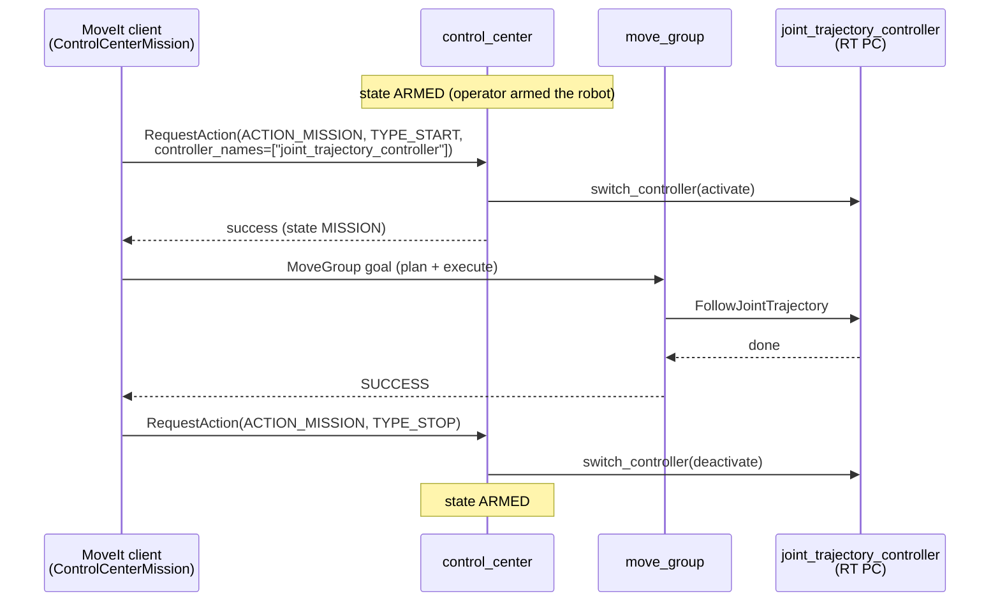

# robotarm_motion

Python client for running MoveIt motions on the robotarm, including the **control_center mission
handshake** that is needed on the real robot and the firmware mock.

- `robotarm_motion/moveit_client.py`: `MoveItClient` sends motion requests to `move_group`
  (MoveGroup action `/move_action`, FK service `/compute_fk`). It has helpers for joint goals,
  TCP pose goals, named states (SRDF), OMPL and Pilz requests, and cancelling.
- `robotarm_motion/mission.py`: `ControlCenterMission`, a context manager that starts and stops a
  control_center mission for `joint_trajectory_controller` and aborts MoveIt goals on STOP.
- `robotarm_motion/demo_motions.py`: test/demo CLI (`ros2 run robotarm_motion demo_motions`).

The MoveIt configuration itself (SRDF, limits, planners, launch files) is in
[`robotarm_moveit_config`](../robotarm_moveit_config/README.md).

## Why a mission?

On the RT PC, `joint_trajectory_controller` (which executes MoveIt trajectories) is spawned
**inactive**. Only `control_center` activates and deactivates controllers. It enforces its state
machine `IDLE → CONNECTED → ARMED → MISSION`, and on STOP/ERROR it deactivates the controller
again. MoveIt is configured so that it never switches controllers itself (see the
robotarm_moveit_config README, "Design decisions").

So a MoveIt client has to:



If the operator triggers STOP during a motion, control_center deactivates the controller. The JTC
aborts its goal and holds the current position. `ControlCenterMission` sees `STOP` on
`/system_status` and cancels the MoveIt goal; every further motion raises `MissionAborted`. The
mission is then over. After `exit_stop` (back to ARMED), a new mission has to be started.

The same happens for every other way control_center can end a mission: ERROR, EMERGENCY, or
`controller_lost`, where the controller left the active state on its own and control_center goes
back to ARMED. The rule is simple: once the mission has been seen as `MISSION`, any other state
counts as aborted.

## Usage in code

```python
import rclpy
from rclpy.node import Node
from robotarm_motion.moveit_client import (
    load_named_states, MoveItClient, PILZ, spin_in_background)
from robotarm_motion.mission import ControlCenterMission

rclpy.init()
node = Node('my_mission')
executor = spin_in_background(node)       # all client calls block, so spin in a thread
moveit = MoveItClient(node, scaling=0.2)  # 20 % of joint_limits.yaml
moveit.wait_for_servers()

with ControlCenterMission(node, moveit) as mission:   # needs control_center in ARMED
    goal = {'axis1': 0.5, 'axis2': -1.0, 'axis3': 1.2, 'axis4': 0.0, 'axis5': 1.0, 'axis6': 0.0}
    mission.execute(moveit.request(PILZ, 'PTP', moveit.joint_goal(goal)))
    # or: named states from the SRDF
    mission.execute(moveit.request(PILZ, 'PTP', moveit.joint_goal(load_named_states()['ready'])))

executor.shutdown()
rclpy.shutdown()
```

`ControlCenterMission(..., controllers=[...])` selects the controller set (default
`['joint_trajectory_controller']`; control_center activates the whole list in one switch request).
`ControlCenterMission(..., arm=True)` also arms the hardware if control_center is only CONNECTED.
It never disarms. Disarming deactivates the hardware, and on the real robot that must be a
conscious operator decision.

## Start state at a joint limit

MoveIt refuses to plan from a state outside the joint limits, even by a fraction of a mrad (a joint
resting on its limit, e.g. the limp arm in the MuJoCo sim). `MoveItClient` therefore checks the
current `/joint_states` against the limits in `/robot_description`. A joint at most 0.01 rad
outside (`START_STATE_CLAMP_TOLERANCE`) is clamped 1 µrad inside the limit and the request gets
this explicit start state. move_group ignores the start state of a request it executes itself, so
such a request is planned first and the trajectory then sent to `/execute_trajectory`; its start
tolerance (0.01 rad) accepts the small difference. A joint further outside is not touched: MoveIt
then reports `START_STATE_INVALID`, and the joint has to be moved back by hand (jogging).

## demo_motions

| Motion | Planner |
|---|---|
| (a) `home` → `ready` | OMPL (RRTConnect), executed |
| (b) `ready` → `home` | Pilz PTP, executed |
| (c) +5 cm in z from `ready` | Pilz LIN, plan only; `--execute-lin` also executes it |

Each motion is checked: the result code, peak joint velocity ≤ scaling × `joint_limits.yaml`, the
goal reached according to `/joint_states`, and for LIN a straight TCP path of the right length.

```bash
# against robotarm_moveit_config demo.launch.py (controller always active, no control_center)
ros2 run robotarm_motion demo_motions

# against the firmware mock or the real robot, with control_center running
ros2 run robotarm_motion demo_motions --mission            # control_center must be ARMED
ros2 run robotarm_motion demo_motions --mission --arm      # arms first if only CONNECTED

# options
--scaling 0.2      # velocity/acceleration scaling (default 0.5; use 0.1 on first hardware tests)
--execute-lin      # execute the LIN motion as well
--dz 0.03          # LIN distance in z [m]
```
