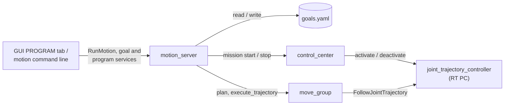

# robotarm_motion

MoveIt motions for the robotarm: **goals** (joint values or tcp poses) and **programs** (sequences
of steps) in a YAML file, the **motion_server** that owns that file and plans and executes jobs,
and the `motion` command line. The operator GUI's **PROGRAM** tab is a client of the same server.

The MoveIt configuration (SRDF, limits, planners, launch files, how to start everything) is in
[`robotarm_moveit_config`](../robotarm_moveit_config/README.md). The interfaces (`RunMotion.action`,
the goal and program services and messages) are in `robotarm_interface`.

| File | Content |
|---|---|
| `robotarm_motion/goals.py` | goals file format, validation, segmentation (no ROS) |
| `robotarm_motion/goal_msgs.py` | conversions between the goals model and the interface messages |
| `robotarm_motion/planner.py` | planning (IK with seed, Pilz sequences, OMPL), blend radius check |
| `robotarm_motion/motion_server.py` | jobs (`/motion_server/run`) and the goal and program services |
| `robotarm_motion/mission.py` | `ControlCenterMission`: mission handshake, abort on STOP |
| `robotarm_motion/moveit_client.py` | `MoveItClient`: move_group requests, execution, cancel, FK, start state at a limit |
| `robotarm_motion/cli.py` | `ros2 run robotarm_motion motion ...` |
| `robotarm_motion/demo_motions.py` | test motions directly through move_group |
| `config/goals_example.yaml` | example goals and programs |
| `launch/motion_server.launch.py` | the motion_server (included by `robot_bringup` `launch_robot.py`) |



## Goals file

`$ROS_HOME/robotarm_motion/goals.yaml` (`~/.ros/...`), outside the repository so every robot keeps
its own poses; another file through the motion_server parameter `goals_file`. Start from the
example: `cp install/robotarm_motion/share/robotarm_motion/config/goals_example.yaml ~/.ros/robotarm_motion/goals.yaml`.

```yaml
goals:
  left:                                   # joint goal [deg], axis1..axis6
    joints_deg: [40, -74.48, 85.94, 0, 57.3, 0]
  front_left:                             # Cartesian goal: tcp pose in the base frame
    xyz: [0.3818, 0.2418, 0.3558]         # [m]
    rpy_deg: [180, -21.25, 30]            # fixed axes x, y, z
    seed_deg: [30, -74.48, 85.94, 0, 57.3, 0]   # optional IK seed
programs:
  square:
    - ready                               # short form: goal name, PTP
    - {goal: ready, motion: LIN, offset_xyz: [0, 0, 0.05], blend: 0.01}
    - {goal: ready, motion: LIN, offset_xyz: [0, 0, -0.05], offset_frame: tcp}
```

- Also possible: `joints: [...]` in rad, `quat: [x, y, z, w]` instead of `rpy_deg`.
- `home` and `ready` (SRDF named states) always exist; a goal of the same name overrides them.
- **Joint goals** are unambiguous. **Cartesian goals** fix only the tcp pose; the seed (the joints
  at teach time) keeps PTP/OMPL in the taught arm configuration.
- Only the motion_server reads and writes the file. It is re-read for every request, so edits by
  hand take effect immediately; teach/save rewrite it and drop comments.

## Programs

| Step key | Default | Meaning |
|---|---|---|
| `goal` | required | goal name |
| `motion` | `PTP` | `PTP` (Pilz, joint space), `LIN` (Pilz, straight tcp line), `OMPL` (collision-free path) |
| `blend` | 0 | [m] blend radius: the tcp passes the goal this close without stopping |
| `scaling` | job speed | speed of this step (0..1] |
| `offset_xyz` | none | [m] added to the goal's tcp position |
| `offset_frame` | `base` | `base` frame, or `tcp`: along the goal's tool axes (approach/retreat) |

1. Consecutive PTP/LIN steps form one blended Pilz sequence; an OMPL step is a segment of its own
   and the robot stops before and after it. A blend where the robot has to stop is ignored and
   reported.
2. **Everything is planned first**, each segment from the end of the previous one. If any step
   cannot be planned, nothing moves.
3. Blend radii are checked before planning, as Pilz checks them: smaller than the distance to the
   neighbouring goals, and neighbouring blend spheres must not overlap. Errors name the step.
4. Joint goal → joint constraints; Cartesian goal or offset → tcp pose for LIN, joint goal from IK
   (with seed) for PTP/OMPL.

CIRC is not supported in programs yet. Pilz blending can fail at higher speeds ("Blending
failed"): use a smaller blend or a lower speed.

## GUI: PROGRAM tab

The right side of the operator GUI switches between **MONITOR** (plots) and **PROGRAM**; the
position bar under the header always shows the joints and the tcp pose. Manual control (JOINT,
CARTESIAN, COMPLIANCE) stays on the left.

- **Goals**: teach the current pose as joint or Cartesian goal (empty name = automatic `p1`,
  `p2`, ...), edit a goal's values (double-click), delete, move to it.
- **Program**: table with goal, motion, blend [mm], speed [%], offset [mm] and its frame; add,
  reorder and remove steps; New / Save / Delete (optionally with its automatically named goals).
- **Teach & append** (or **Space**): saves the current pose as `<program>_p<N>` and appends it as
  a step. Typical: hand guiding (COMPLIANCE, left) → move the arm → Space → move → Space ...
- **Re-teach goal** overwrites the selected step's goal; **Move to step** runs that step alone.
- **Run bar**: PLAN (shown in RViz, nothing moves) and RUN work on the table as it is, saved or
  not. The executing steps are highlighted, a failing step is marked red. RUN needs the robot
  ARMED and no manual mission active; while a program runs, the left column is locked.

## motion command line

```
ros2 run robotarm_motion motion <command>
  list                                     goals and programs
  teach [NAME] [--cartesian] [--force] [--prefix P]   current pose as goal (no NAME: <P><N>)
  remove NAME                              delete a goal (refused while a program uses it)
  program list | show NAME | remove NAME [--with-goals]
  run PROGRAM [--plan-only] [--scaling S]
  move GOAL [--motion PTP|LIN|OMPL] [--plan-only] [--scaling S]
```

Every command goes through the motion_server. Ctrl-C during `run`/`move` cancels the job.

## motion_server

For each job (program, single goal, or the steps of an unsaved program) it checks the steps,
plans everything, shows the plan in RViz (`display_planned_path`), and unless `plan_only` starts a
control_center mission for `joint_trajectory_controller`, executes the segments through
move_group (`/execute_trajectory`) and ends the mission. One job at a time.

- move_group checks every segment's start (0.01 rad) and its duration (1.2 × planned + 0.5 s).
- **STOP, ERROR, EMERGENCY or a lost controller**: control_center deactivates the controller, the
  job aborts with that reason, no further segment runs.
- **Cancel**: move_group (MoveIt 2.12) only handles a cancel request after the execution has
  finished, so the server also publishes `stop` on `/trajectory_execution_event`; the arm holds
  within a few hundred ms and the mission ends.
- **Teach** is refused while a job runs and while a joint moves faster than `teach_max_velocity`.
- RViz *Execute* during a job would replace the running segment (not guarded: same operator).

| Service (`/motion_server/...`) | Type | |
|---|---|---|
| `get_goals` | `GetGoals` | goals (incl. SRDF states), programs, file path |
| `teach_goal` | `TeachGoal` | save the current pose (`name` or auto `prefix`, `cartesian`, `overwrite`) |
| `set_goal` | `SetGoal` | create or change a goal from values |
| `remove_goal` | `RemoveGoal` | delete a goal |
| `set_program` | `SetProgram` | create or replace a program; blend problems come back as `warnings` |
| `remove_program` | `RemoveProgram` | delete a program, optionally its unused `<name>_p<N>` goals |

Action `/motion_server/run` (`RunMotion`): exactly one of `program`, `goal` (+ `motion`) or
`steps`; `scaling`, `plan_only`. Feedback: `phase`, `segment`/`segments`, `step_from`/`step_to`.
Result: `success`, `message`, `duration`, `segments`, `failed_step_from`/`failed_step_to`.

```bash
ros2 action send_goal --feedback /motion_server/run robotarm_interface/action/RunMotion "{program: square, plan_only: true}"
```

| Parameter | Default | |
|---|---|---|
| `goals_file` | `$ROS_HOME/robotarm_motion/goals.yaml` | |
| `default_scaling` | 0.2 | speed of jobs that do not set one |
| `controller` | `joint_trajectory_controller` | controller of the mission |
| `arm` | false | arm the hardware if control_center is only CONNECTED |
| `teach_max_velocity` | 0.02 | [rad/s] stillness check before teaching |
| `use_sim_time` | false | true with the MuJoCo sim |

## Missions

`joint_trajectory_controller` is spawned inactive; only control_center switches controllers (armed
check, one mission at a time, deactivation on STOP/ERROR). A job asks for a mission with
`controller_names=["joint_trajectory_controller"]`, executes, and ends it; control_center
activates and deactivates `ff_controller` (feedforward, chained below) in the same request.
Trajectories must carry accelerations (they become feedforward torque); `MoveItClient` refuses to
execute one without them. Once `/system_status`
has reported MISSION, any other state counts as aborted; after a failed motion the server waits up
to 1 s for the status, so it reports the real cause (STOP, controller lost).

## Usage in code

Recommended: send a `RunMotion` goal to `/motion_server/run`, as `cli.py` does. Directly through
move_group, in an own mission (only when no motion_server job runs):

```python
from robotarm_motion.mission import ControlCenterMission
from robotarm_motion.moveit_client import load_named_states, MoveItClient, PILZ, spin_in_background

executor = spin_in_background(node)       # calls block, so spin in a thread
moveit = MoveItClient(node, scaling=0.2)
moveit.wait_for_servers()
with ControlCenterMission(node, moveit) as mission:   # needs control_center in ARMED
    mission.execute(moveit.request(PILZ, 'PTP', moveit.joint_goal(load_named_states()['ready'])))
```

`ControlCenterMission(..., arm=True)` arms first if only CONNECTED (it never disarms).

## Start state at a joint limit

MoveIt refuses a start state outside the joint limits, even by a fraction of a mrad (a joint
resting on its limit, e.g. the limp arm in the MuJoCo sim). `MoveItClient` clamps a joint that is
at most 0.01 rad outside onto the limit and plans from there; move_group's start tolerance accepts
the difference. Further outside: `START_STATE_INVALID`, jog the joint back first.

## demo_motions and tests

`ros2 run robotarm_motion demo_motions [--mission [--arm]] [--scaling S] [--execute-lin]` runs
OMPL `home → ready`, Pilz PTP back, and a Pilz LIN of +5 cm, and checks result code, peak velocity,
goal reached and the straight LIN path. Without `--mission` for the standalone demo.

```bash
colcon test --packages-select robotarm_motion && colcon test-result --verbose
```

`test/test_goals.py`: file format, steps, programs, names, rotations, segmentation (no ROS needed);
plus flake8 and pep257.
