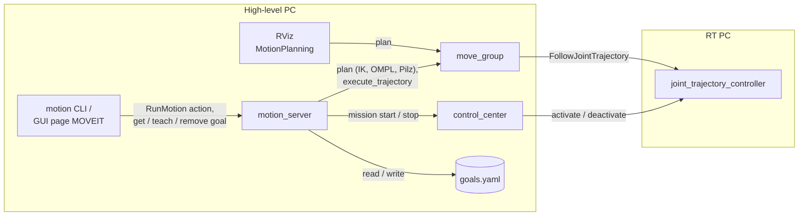
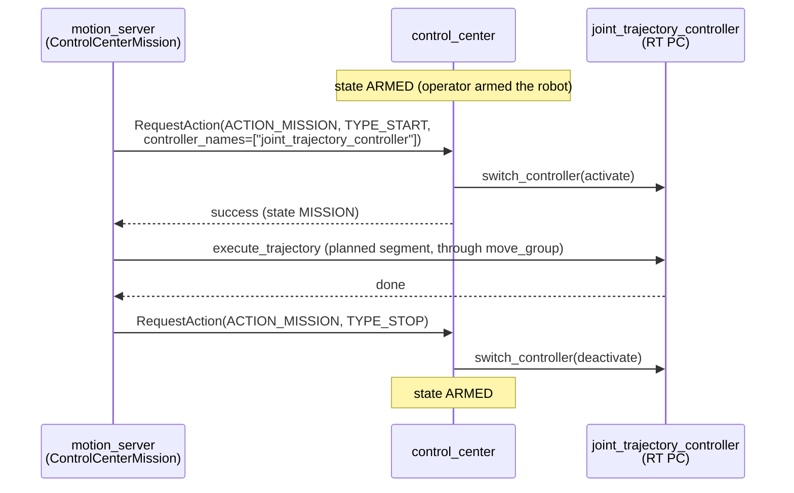

# robotarm_motion

MoveIt motions for the robotarm: **goals** (joint values or tcp poses) and **programs** (sequences
of motions) in a YAML file, the **motion_server** that plans and executes them, and a command line.

The motion_server plans every job completely, then executes it through move_group inside its own
control_center mission. It also owns the goals file: the command line and the GUI read, teach and
remove goals through its services and never touch the file themselves.

The MoveIt configuration itself (SRDF, limits, planners, launch files) is in
[`robotarm_moveit_config`](../robotarm_moveit_config/README.md).

| File | Content |
|---|---|
| `robotarm_motion/goals.py` | goals file format: goals, programs, validation, segmentation (no ROS) |
| `robotarm_motion/planner.py` | plans goals and programs with MoveIt (plan only), IK with seed, Pilz sequences |
| `robotarm_motion/motion_server.py` | jobs (action `/motion_server/run`) and the goal services |
| `robotarm_motion/goal_msgs.py` | conversions between the goals file model and the interface messages |
| `robotarm_motion/mission.py` | `ControlCenterMission`: control_center mission handshake, abort on STOP |
| `robotarm_motion/moveit_client.py` | `MoveItClient`: requests to move_group, execution, cancel, FK, start state at joint limits |
| `robotarm_motion/cli.py` | command line `ros2 run robotarm_motion motion ...` |
| `robotarm_motion/demo_motions.py` | test motions directly through move_group (without the motion_server) |
| `config/goals_example.yaml` | example goals and programs |
| `launch/motion_server.launch.py` | starts the motion_server (included by `robot_bringup` `launch_robot.py`) |
| `test/test_goals.py` | unit tests of the goals file format |

The interfaces of the motion_server (`RunMotion.action`, `GetGoals.srv`, `TeachGoal.srv`,
`RemoveGoal.srv`, `MotionGoal.msg`, `MotionProgram.msg`, `MotionStep.msg`) are in
`robotarm_interface`.



## Quickstart

With the full system running (RT side + `ros2 launch robot_bringup launch_robot.py`, see the
robotarm_moveit_config README, section 4, "Full system: start everything": mock, MuJoCo
sim and real robot) and the robot armed:

```bash
source install/setup.bash
mkdir -p ~/.ros/robotarm_motion          # once: goals file from the example
cp install/robotarm_motion/share/robotarm_motion/config/goals_example.yaml ~/.ros/robotarm_motion/goals.yaml
ros2 run robotarm_motion motion list                 # goals (incl. home/ready) and programs
ros2 run robotarm_motion motion run square --plan-only   # plan, show in RViz, nothing moves
ros2 run robotarm_motion motion run square           # plan and execute (5 cm square, blended)
ros2 run robotarm_motion motion move left            # single goal, PTP
ros2 run robotarm_motion motion teach my_pose        # save the current pose as joint goal
ros2 run robotarm_motion motion teach my_frame --cartesian   # ... as tcp pose (with seed)
```

Arming (the GUI's ARM button, or
`ros2 service call /request_action robotarm_interface/srv/RequestAction "{node_name: operator, action_id: 1, request_type: 254}"`)
stays an operator action; the motion_server never arms by itself (parameter `arm`, default false).

## Goals file

Default location: `$ROS_HOME/robotarm_motion/goals.yaml` (`~/.ros/...`), outside the repository,
so every robot keeps its own taught poses. Another file: the motion_server parameter `goals_file`
(launch argument `goals_file:=` of `motion_server.launch.py`). A file in a repository works the same
way if a team wants to share one. Only the motion_server reads and writes the file; it may be
missing (no goals except the SRDF states until the first teach).

```yaml
goals:
  left:                        # joint goal [deg], axis1..axis6 (or a dict {axis1: ..., ...})
    joints_deg: [40, -74.48, 85.94, 0, 57.3, 0]
  front_left:                  # Cartesian goal: tcp pose in the base frame
    xyz: [0.3818, 0.2418, 0.3558]          # [m]
    rpy_deg: [180, -21.25, 30]             # roll, pitch, yaw [deg], fixed axes x, y, z (as URDF)
    seed_deg: [30, -74.48, 85.94, 0, 57.3, 0]   # optional, see below
programs:
  square:
    - ready                    # short form: goal name, PTP
    - {goal: ready, motion: LIN, offset_xyz: [0, 0, 0.05], blend: 0.01}
    - ...
```

- Radians instead of degrees: `joints: [...]`; orientation as quaternion: `quat: [x, y, z, w]`.
- `home` and `ready` (named states of the SRDF) are always available; a goal of the same name in
  the file overrides them.
- **Joint goals** are unambiguous: the arm always ends in exactly this configuration. Best for
  taught poses.
- **Cartesian goals** describe only the tcp pose. A 6-axis arm usually reaches it in several
  configurations (elbow up/down, wrist flipped), and the IK solver may choose any of them. The
  `seed` (the joints at teach time, written by `motion teach --cartesian`) makes PTP and OMPL
  motions use the IK solution next to it. Without a seed the start of the motion is the seed.
- Teach and remove (command line or GUI) rewrite the file: comments written by hand are lost then.
- The file is read for every job and every request, so edits by hand take effect without a restart.

## Programs

A program is a list of steps. Each step moves to a goal:

| Key | Default | Meaning |
|---|---|---|
| `goal` | (required) | goal name |
| `motion` | `PTP` | `PTP` (Pilz, joint space, all axes synchronous), `LIN` (Pilz, straight tcp line), `OMPL` (collision-free path, any shape) |
| `blend` | 0 | [m] blend radius: the tcp passes this close to the goal without stopping and continues to the next step |
| `scaling` | job scaling | velocity/acceleration scaling of this step (0..1] |
| `offset_xyz` | none | [m] added to the goal's tcp position in the base frame, e.g. `[0, 0, 0.05]` = 5 cm above |

How a program is planned and executed:

1. **Segments**: consecutive Pilz steps (PTP, LIN) form one Pilz sequence, planned and executed as
   one trajectory, with the blend radii rounding the transitions. An `OMPL` step is a segment of its
   own; the robot stops before and after it. A blend radius where the robot has to stop (last step,
   before or on an OMPL step) is ignored and reported in the result message.
2. **Everything is planned first**, each segment from the end of the previous one. If any step
   cannot be planned (unreachable pose, collision, limits), nothing moves.
3. Goal types per motion: joint goal → joint constraints; Cartesian goal (or `offset_xyz`) →
   tcp pose for LIN, joint goal from IK (with seed) for PTP/OMPL.
4. Blend radii of neighbouring steps must not overlap (each smaller than half the distance between
   the goals), otherwise Pilz refuses the sequence (`INVALID_MOTION_PLAN`).

CIRC (arcs) is not supported in programs yet (it needs an interim or center point).

## GUI: MOVEIT page

The operator GUI (`gui`) has a page **MOVEIT** next to JOINT, CARTESIAN and COMPLIANCE
(`gui/gui/motion_widget.py`). It is a client of the motion_server like the command line:

- **Target**: a program (▶) or a goal (●) from the motion_server (`get_goals`), for a goal also
  the motion type (PTP/LIN/OMPL); ⟳ asks the server again.
- **Speed Scale**: scaling of the job (5–100 %, default 20 %).
- **PLAN**: plan only and show the result in RViz, nothing moves (works without arming).
- **EXECUTE**: plan everything, then execute; enabled only when the robot is ARMED and no other
  mission (e.g. jogging) is active. While the job runs, the page navigation is locked like during
  any mission (the motion_server's mission shows in `active_node`).
- **CANCEL**: cancel the running job, the robot stops and holds, the mission ends.
- **Teach current pose**: the motion_server saves the current pose as joint goal or as Cartesian
  goal (tcp pose from move_group's FK, current joints as IK seed); a goal of the file with the same
  name is replaced, names of SRDF states are refused.

The page needs the motion_server (`launch_robot.py`, `moveit:=true`) and a loaded
`joint_trajectory_controller` on the RT PC; otherwise it shows why it is disabled. In the main
window only four lines were added (import, page, nav button, update call).

## motion command line

```
ros2 run robotarm_motion motion <command>
  list                            goals and programs
  teach NAME [--cartesian] [--force]   save the current pose as goal NAME (--force: replace)
  remove NAME                     delete goal NAME (refused while a program uses it)
  run PROGRAM [--plan-only] [--scaling S]
  move GOAL [--motion PTP|LIN|OMPL] [--plan-only] [--scaling S]
```

Every command is a client of the motion_server (it has to run). `run` and `move` send a job and
print its phases and result. Ctrl-C cancels the job: the execution stops, the controller holds the
current position and the mission is stopped.

## motion_server

For each job (a program or a single goal) the server

1. loads the goals file, splits the program into segments and plans all of them (plan only),
2. shows the whole plan in RViz (topic `display_planned_path`),
3. unless `plan_only`: starts a control_center mission for `joint_trajectory_controller`, executes the
   planned segments one after the other through move_group (`/execute_trajectory`), stops the
   mission.

move_group checks every segment before it sends it to the controller (start within 0.01 rad of the
current state, `allowed_start_tolerance` in `moveit_controllers.yaml`) and stops it if it takes
longer than 1.2 × duration + 0.5 s. The controller accepts the trajectory only while the mission
keeps it active. One job at a time: a second goal is rejected while one runs.

Cancel (Ctrl-C, GUI CANCEL): move_group (MoveIt 2.12) handles a cancel request only after the
execution has finished, so `MoveItClient.cancel()` also publishes `stop` on
`/trajectory_execution_event` (as RViz's Stop button). The execution ends with PREEMPTED, the
controller holds, the mission is stopped.

STOP, ERROR, EMERGENCY or a lost controller during a job: control_center deactivates the controller
(it aborts the trajectory and holds), the server sees the state change on `/system_status`, reports
`aborted, control_center switched to STOP` and does not execute further segments.

`robot_bringup` `launch_robot.py` starts the motion_server together with move_group
(`moveit:=true`). move_group can execute: outside a mission the controller is inactive and rejects
every trajectory (RViz *Execute* fails, nothing moves). During a job, RViz *Execute* would replace
the running segment; RViz runs from the same launch file as the GUI and is used by the same
operator, so this is not guarded. A node that sends trajectories or switches controllers past
control_center is not prevented either (see the robotarm_moveit_config README, section 7); that
needs access control on the ROS network (SROS2).

Goal services (`robotarm_interface`):

| Service | Type | |
|---|---|---|
| `/motion_server/get_goals` | `GetGoals` | goals (incl. SRDF states), programs, path of the file |
| `/motion_server/teach_goal` | `TeachGoal` | save the current pose as `name` (`cartesian`, `overwrite`); refused while a job runs |
| `/motion_server/remove_goal` | `RemoveGoal` | delete a goal (refused while a program uses it) |

Parameters (`launch/motion_server.launch.py`):

| Parameter | Default | |
|---|---|---|
| `goals_file` | `$ROS_HOME/robotarm_motion/goals.yaml` | |
| `default_scaling` | 0.2 | scaling of jobs that do not set one |
| `controller` | `joint_trajectory_controller` | controller and action namespace |
| `arm` | false | arm the hardware if control_center is only CONNECTED |
| `use_sim_time` | false | true with the MuJoCo sim |

Action `/motion_server/run` (`robotarm_interface/action/RunMotion`): goal `program` or `goal`
(+ `motion`), `scaling`, `plan_only`; result `success`, `message`, `duration`,
`segments`; feedback `phase` (PLANNING, STARTING_MISSION, EXECUTING, STOPPING_MISSION), `segment`,
`segments`. From the command line:

```bash
ros2 action send_goal --feedback /motion_server/run robotarm_interface/action/RunMotion \
  "{program: square, plan_only: true}"
```

## Why a mission?

On the RT PC, `joint_trajectory_controller` (which executes MoveIt trajectories) is spawned
**inactive**. Only `control_center` activates and deactivates controllers. It enforces its state
machine `IDLE → CONNECTED → ARMED → MISSION`, allows one mission at a time, and on STOP/ERROR
deactivates the controller again. MoveIt never switches controllers itself (see the
robotarm_moveit_config README, "Design decisions").



Once the mission has been seen as `MISSION`, any other state (STOP, ERROR, EMERGENCY, or ARMED after
`controller_lost`) counts as aborted. After a failed motion the client waits up to 1 s for the
status, because MoveIt and the controller report the failure faster than control_center notices
a lost controller.

## Usage in code

Through the motion_server (recommended): send a `RunMotion` goal to `/motion_server/run`, as `cli.py`
does.

Directly through move_group, in an own mission (standalone demo, or the full system when no job of
the motion_server runs):

```python
import rclpy
from rclpy.node import Node
from robotarm_motion.moveit_client import (
    load_named_states, MoveItClient, PILZ, spin_in_background)
from robotarm_motion.mission import ControlCenterMission

rclpy.init()
node = Node('my_mission')
executor = spin_in_background(node)       # all client calls block, so spin in a thread
moveit = MoveItClient(node, scaling=0.2)  # 20 % of joint_limits.yaml
moveit.wait_for_servers()

with ControlCenterMission(node, moveit) as mission:   # needs control_center in ARMED
    goal = {'axis1': 0.5, 'axis2': -1.0, 'axis3': 1.2, 'axis4': 0.0, 'axis5': 1.0, 'axis6': 0.0}
    mission.execute(moveit.request(PILZ, 'PTP', moveit.joint_goal(goal)))
    mission.execute(moveit.request(PILZ, 'PTP', moveit.joint_goal(load_named_states()['ready'])))

executor.shutdown()
rclpy.shutdown()
```

`ControlCenterMission(..., controllers=[...])` selects the controller set (default
`['joint_trajectory_controller']`; control_center activates the whole list in one switch request).
`ControlCenterMission(..., arm=True)` also arms the hardware if control_center is only CONNECTED.
It never disarms. Disarming deactivates the hardware, and on the real robot that must be a
conscious operator decision.

## Start state at a joint limit

MoveIt refuses to plan from a state outside the joint limits, even by a fraction of a mrad (a joint
resting on its limit, e.g. the limp arm in the MuJoCo sim). `MoveItClient` therefore checks the
current `/joint_states` against the limits in `/robot_description`. A joint at most 0.01 rad
outside (`START_STATE_CLAMP_TOLERANCE`) is clamped 1 µrad inside the limit and the request gets
this explicit start state. The motion_server plans every job from this clamped state and sends the
trajectories to `/execute_trajectory`; for MoveGroup requests that should also execute (move_group
ignores their start state), `MoveItClient` plans first and does the same. In both cases the start tolerance (0.01 rad) accepts the
small difference. A joint further outside is not touched: MoveIt then reports
`START_STATE_INVALID`, and the joint has to be moved back by hand (jogging).

## demo_motions

Test motions directly through move_group, without the motion_server (standalone demo, or the full
system with `--mission`):

| Motion | Planner |
|---|---|
| (a) `home` → `ready` | OMPL (RRTConnect), executed |
| (b) `ready` → `home` | Pilz PTP, executed |
| (c) +5 cm in z from `ready` | Pilz LIN, plan only; `--execute-lin` also executes it |

Each motion is checked: the result code, peak joint velocity ≤ scaling × `joint_limits.yaml`, the
goal reached according to `/joint_states`, and for LIN a straight TCP path of the right length.

```bash
ros2 run robotarm_motion demo_motions                 # standalone demo (demo.launch.py)
ros2 run robotarm_motion demo_motions --mission       # full system (own control_center mission)
ros2 run robotarm_motion demo_motions --mission --arm # ... arms first if only CONNECTED
#   --scaling 0.2  --execute-lin  --dz 0.03
```

## Tests

```bash
colcon test --packages-select robotarm_motion && colcon test-result --verbose
```

`test/test_goals.py`: goal and step parsing, rotations, save/load, removal, segmentation (no ROS
needed); plus flake8 and pep257.
