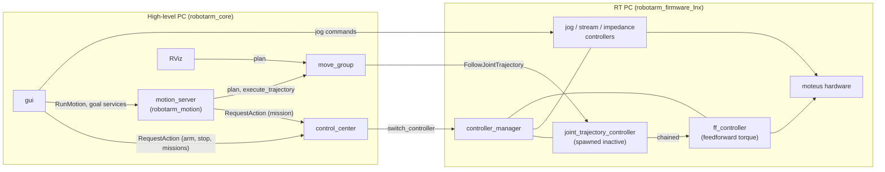

# robotarm_moveit_config

MoveIt 2 (ROS 2 Jazzy) configuration for the 6-axis robotarm: planning group, named poses, collision
matrix, IK (pick_ik), limits, planning pipelines (OMPL and Pilz) and the connection to ros2_control.
It also contains a standalone demo with mock hardware. Configuration and launch files only; the
Python client, goals and programs are in [`robotarm_motion`](../robotarm_motion/README.md).

The layout matches a package generated by the MoveIt Setup Assistant, so the Setup Assistant can
open and edit it ([Setup Assistant](#collision-matrix-and-setup-assistant)).

## Architecture



| Component | Runs on | Responsibility |
|---|---|---|
| ros2_control (controllers, moteus hardware) | RT PC | real-time loop, `/joint_states`, `/tf` |
| `control_center` | high-level PC | state machine (IDLE → CONNECTED → ARMED → MISSION), the only node that switches controllers |
| `move_group` (this package) | high-level PC | planning; executes on `joint_trajectory_controller` while that is active |
| `motion_server` (`robotarm_motion`) | high-level PC | goals and programs, runs MoveIt jobs inside its own mission |

`joint_trajectory_controller` is inactive until a mission activates it, so a MoveIt execution
outside a mission is rejected and nothing moves. Like `joint_stream_controller` and
`cartesian_jog_controller`, it is chained onto `ff_controller`, which adds feedforward torque;
control_center activates and deactivates `ff_controller` in the same request as these three.

## Files

| File | Content |
|---|---|
| `.setup_assistant` | URDF (`robotarm_description`, xacro args `use_hardware:=false tool:=axis_triad`) and SRDF location |
| `config/robotarm.srdf` | group `arm`, named states, disabled collision pairs |
| `config/kinematics.yaml` | IK: pick_ik, `global` mode, 0.1 mm / 0.001 rad thresholds |
| `config/joint_limits.yaml` | velocity/acceleration limits, default scaling 0.1 — **PRELIMINARY** |
| `config/pilz_cartesian_limits.yaml` | TCP limits for Pilz LIN/CIRC: 0.1 m/s, 0.25 m/s², 0.5 rad/s — **PRELIMINARY** |
| `config/ompl_planning.yaml` | OMPL pipeline, default `RRTConnect` |
| `config/pilz_industrial_motion_planner_planning.yaml` | Pilz pipeline and sequence capability |
| `config/moveit_controllers.yaml` | `moveit_simple_controller_manager` → `joint_trajectory_controller`, execution tolerances |
| `config/ros2_controllers.yaml` | ros2_control for the demo only (the RT PC has its own) |
| `config/moveit.rviz` | RViz: solid robot = actual state (RobotModel, `/tf`), see-through = planned motion (Trajectory), collision objects (PlanningScene), frames (TF); no MotionPlanning display. Installed as a symlink with `--symlink-install`, so *File → Save Config* writes here |
| `launch/demo.launch.py` | standalone demo with mock hardware (`rviz:=`) |
| `launch/move_group.launch.py` | move_group (+ RViz) against the real ros2_control stack (`rviz:=`, `tool:=`, `use_sim_time:=`, `allow_trajectory_execution:=`) |
| `launch/setup_assistant.launch.py` | Setup Assistant on the *installed* copy |

**SRDF details**
- Group `arm`: chain `base → tcp`, joints `axis1..axis6`. The `tool` xacro argument decides where
  `tcp` is (`axis_triad`: 0.118 m in front of the flange, `none`: on the flange).
- Named states: `home` (all 0, arm stretched forward, singular) and `ready`
  (`0, -1.3, 1.5, 0, 1.0, 0`, TCP about x = 0.45 m, z = 0.36 m; `axis5 = 1.0` keeps the wrist away
  from its singularity). Start Cartesian motions from `ready`-like poses.
- No virtual joint: `base` is the root and the planning frame.

**Joint limits** (`joint_limits.yaml`): axis1–3 0.8 rad/s, 1.5 rad/s²; axis4–6 1.0 rad/s,
2.0 rad/s². Position limits come from the URDF; the velocities must stay below the URDF `velocity`
(2.5–3.14 rad/s) or Pilz refuses to plan. Raise them only after measuring on the hardware.

## Design decisions

- **OMPL and Pilz.** OMPL plans collision-free paths around obstacles, but they are random and not
  straight. Pilz plans predictable industrial motions (PTP, LIN, CIRC) with trapezoidal profiles,
  but does not avoid obstacles; it only rejects a colliding result. Both are loaded; each request
  picks one with `pipeline_id` / `planner_id`.
- **pick_ik instead of KDL.** Better success far from the seed, optional cost terms, works for any
  chain without code generation. Our own analytic IK can replace it later
  ([Own IK](#own-ik)).
- **Conservative limits.** The URDF has motor limits, not tested motion limits, and no acceleration
  limits. The limits here are low and the default scaling is 10 %; raise them step by step.
- **`moveit_simple_controller_manager`, never switching controllers.** Controller switching belongs
  to `control_center` (armed check, one mission at a time, deactivation on STOP/ERROR, adding
  `ff_controller` below the position controllers). MoveIt only knows the action name of
  `joint_trajectory_controller`; `moveit_manage_controllers=False` makes this explicit.
- **Trajectories with accelerations.** `joint_trajectory_controller` passes accelerations on to
  `ff_controller` as feedforward torque; without them the torque jumps at every point. OMPL gets
  them from the time parameterization (`AddTimeOptimalParameterization`), Pilz computes them;
  `robotarm_motion` refuses to execute a trajectory without them.

## Quickstart

### Build

```bash
cd /robotarm_core && source /opt/ros/jazzy/setup.bash
rosdep install --from-paths src --ignore-src -y   # only outside the devcontainer or after adding a dependency
colcon build && source install/setup.bash
```

### Standalone demo (no robot, no control_center)

```bash
ros2 launch robotarm_moveit_config demo.launch.py            # rviz:=false for headless
ros2 run robotarm_motion demo_motions                        # OMPL, Pilz PTP and LIN test motions
```

Here `joint_trajectory_controller` is always active, so RViz's own planning works: **Add** the
display `moveit_rviz_plugin/MotionPlanning` (not in the default config, because it always opens
its panel and its Execute needs a mission on the real robot); tab **Planning**, group `arm`; drag
the marker at the TCP or pick a **Goal State**; set the scaling; **Plan**, then **Execute**. Don't
save the config with it, or remove it again before saving. Pilz is
selected in the **Context** tab (`pilz_industrial_motion_planner`, `PTP` or `LIN`).

### Full system: mock, MuJoCo sim or real robot

**Never run two RT sides at once** (mock, sim, real robot or `demo.launch.py`) in the same
`ROS_DOMAIN_ID`: each provides `/controller_manager` and `/joint_states`.

Once: build the firmware (main branch; it has `joint_trajectory_controller` and `ff_controller`):

```bash
cd <robotarm_firmware_lnx>
git -c url."https://github.com/".insteadOf="git@github.com:" submodule update --init
source /opt/ros/jazzy/setup.bash && rosdep install --from-paths src --ignore-src -y -r && colcon build
```

The standalone `demo.launch.py` has no `ff_controller`: position missions through control_center
(jogging, PROGRAM jobs) only work against the firmware's mock, sim or hardware.

Goals file for the motion_server, once (see `robotarm_motion`):

```bash
mkdir -p ~/.ros/robotarm_motion
cp /robotarm_core/install/robotarm_motion/share/robotarm_motion/config/goals_example.yaml ~/.ros/robotarm_motion/goals.yaml
```

Terminal 1, RT side (wait until `joint_trajectory_controller ... inactive` is listed by
`ros2 control list_controllers`):

```bash
cd <robotarm_firmware_lnx> && source install/setup.bash
ros2 launch robotarm_bringup robotarm_mock.launch.py tool:=axis_triad   # A: mock
ros2 launch robotarm_mujoco sim.launch.py tool:=axis_triad              # B: MuJoCo sim
ros2 launch robotarm_bringup robotarm_hardware.launch.py tool:=none     # C: real robot
```

Terminal 2, high-level side (control_center, move_group, motion_server, GUI, RViz):

```bash
cd /robotarm_core && source install/setup.bash
ros2 launch robot_bringup launch_robot.py tool:=axis_triad                    # A
ros2 launch robot_bringup launch_robot.py tool:=axis_triad use_sim_time:=true # B
ros2 launch robot_bringup launch_robot.py tool:=none                          # C
#   options: moveit:=false  rviz:=false  gui:=false
```

With the sim (B), `use_sim_time:=true` is required (VS Code task "Run Sim"): the sim stamps
`/joint_states` with its own clock, and without it move_group refuses every execution ("Didn't
receive robot state ... with recent timestamp", the job fails with `CONTROL_FAILED`). Mock and real
robot use wall-clock time, so leave it off there.

No windows ("Authorization required")? Run `xhost +local:` on the host and start again.

**Pass the mounted tool on both sides.** The defaults differ: firmware mock `axis_triad`, firmware
hardware and sim `none`, this repository `axis_triad`. A mismatch puts MoveIt's tcp 0.118 m off and
gives it a wrong collision model; with another tool, regenerate the collision matrix.

### Operate

- **Arm**: ARM in the GUI header, or
  `ros2 service call /request_action robotarm_interface/srv/RequestAction "{node_name: operator, action_id: 1, request_type: 254}"`.
- **Move**: GUI tab **PROGRAM** or the `motion` command line (`robotarm_motion` README).
- **Stop**: STOP in the GUI header (the job aborts, the arm holds), RESUME to continue; or
  `action_id: 11` with `request_type: 254` (stop) / `255` (leave stop).
  (`action_id`: 1 ARM, 2 MISSION, 11 STOP, 12 EMERGENCY; `request_type`: 254 start, 255 stop.)
- **RViz Execute** only moves the arm during a mission. To use it, start one by hand
  (`action_id: 2, request_type: 254, controller_names: [joint_trajectory_controller]`, `255` to end
  it). Do not press Execute while a motion_server job runs: it replaces the running segment.
- **Shut down**: close the GUI, Ctrl-C terminal 2, then terminal 1.

### Real robot: before the first motion

- **Network**: same network, same `ROS_DOMAIN_ID`, `RMW_IMPLEMENTATION=rmw_cyclonedds_cpp` on both
  PCs, containers with `--network=host`; `ros2 node list` on the high-level PC shows
  `/controller_manager`.
- **Clocks**: synchronise both PCs (NTP/chrony). More than about a second apart and MoveIt treats
  the robot state as outdated ("Failed to fetch current robot state").
- **RT PC**: real-time setup and `/dev/fdcanusb` as in the firmware's `docs/REALTIME_SETUP.md`.
- **Safety**: e-stop in reach, nobody in the working area. Every job activates and deactivates
  `joint_trajectory_controller` on the RT PC; make sure these transitions are tested on the hardware.
- **First motions**: jog to a free pose, teach it, jog a few degrees away, plan to it and check the
  path in RViz, then run at 10 %. Compare `/joint_states` with the plan, then raise the limits.

## Collision matrix and Setup Assistant

Regenerate the disabled collision pairs whenever the URDF geometry, the joint limits or the tool
change:

```bash
ros2 run moveit_setup_assistant collisions_updater \
  --urdf $(ros2 pkg prefix robotarm_description)/share/robotarm_description/urdf/robotarm.urdf.xacro \
  --xacro-args "use_hardware:=false tool:=axis_triad" \
  --srdf src/robotarm_moveit_config/config/robotarm.srdf \
  --output src/robotarm_moveit_config/config/robotarm.srdf \
  --default --trials 100000
```

"Never" pairs are statistical (100 000 samples): check the `git diff` and remove a pair by hand if
it can collide. The warning `Found remap rule 'use_hardware:=false'` is harmless.

Open the package in the Setup Assistant from the **source** directory (the launch file opens the
installed copy, whose changes are lost on the next build):

```bash
ros2 run moveit_setup_assistant moveit_setup_assistant --config_pkg=/robotarm_core/src/robotarm_moveit_config
```

Before "Generate Package": add **no** ros2_control interfaces (our URDF has its own block), and
uncheck `package.xml`, `CMakeLists.txt`, the launch files, `ros2_controllers.yaml` and
`moveit_controllers.yaml`, or they are overwritten with templates. The SRDF is rewritten
completely (comments are lost). Review everything with `git diff`.

## Own IK

`robotarm_rbd` implements the ros2_control `kinematics_interface`, not MoveIt's IK interface. To use
it in MoveIt, write a small adapter package (e.g. `robotarm_moveit_ik`):

1. Derive from `kinematics::KinematicsBase` (`<moveit/kinematics_base/kinematics_base.hpp>`).
2. Implement `initialize`, `getPositionIK`, `searchPositionIK` (all closed-form solutions, drop
   those outside the limits or rejected by the callback, return the one closest to the seed),
   `getPositionFK`, `getJointNames`, `getLinkNames`.
3. Export with `PLUGINLIB_EXPORT_CLASS(..., kinematics::KinematicsBase)` and
   `pluginlib_export_plugin_description_file(moveit_core <xml>)`.
4. Switch `config/kinematics.yaml` to `kinematics_solver: robotarm_rbd/MoveItKinematicsPlugin` and
   add the package as `exec_depend`.

References: `kdl_kinematics_plugin` (moveit_kinematics) and pick_ik.

## Pitfalls

- **Mock hardware is perfect** (commands are copied to states): tracking errors and dynamics are not
  simulated. A trajectory that runs in the demo can still fail on the hardware.
- **No obstacles**: the planning scene only has the robot. Add table and fixtures as collision
  objects before using OMPL near them; Pilz does not avoid obstacles at all.
- **A joint resting on its limit** blocks planning (`START_STATE_INVALID`). `robotarm_motion` clamps
  a start up to 0.01 rad outside onto the limit; RViz cannot, jog the joint off its limit first.
- **Pilz LIN near singularities** (`axis5 = 0`, the stretched `home` pose) fails with
  `NO_IK_SOLUTION`.
- **Pilz blending at higher speed** can exceed a joint's deceleration limit ("Blending failed");
  use a smaller blend radius or a lower speed.
- **`/plan_sequence_path` fails every blended sequence** in MoveIt 2.12.4 ("Blending failed"); the
  action `/sequence_move_group` with `plan_only` works and is what `robotarm_motion` uses.
- **`/compute_cartesian_path`** only respects joint limits and ignores `max_cartesian_speed`; use
  Pilz LIN sequences for multi-point Cartesian paths.
- **Cancelling an execution**: move_group (2.12) handles a cancel request of `/execute_trajectory`
  only after the execution has finished. Stop a running execution with `stop` on
  `/trajectory_execution_event` (RViz's Stop button, `robotarm_motion` does this on cancel).
- **pick_ik `global`** can jump to another IK branch while dragging the marker; raise
  `minimal_displacement_weight` in `kinematics.yaml` if that is annoying.
- **Changing the URDF** (names, limits): update the SRDF, `joint_limits.yaml`,
  `moveit_controllers.yaml`, `ros2_controllers.yaml` and regenerate the collision matrix.
- **Harmless messages**: octomap "No 3D sensor plugin" / "Resolution not specified"; KDL "root link
  base has an inertia"; a segmentation fault of move_group on Ctrl-C (MoveIt 2.12.4 shutdown bug).

## Open issues

1. **First run on the real robot**: mock and sim first, then hardware at 10 % with the e-stop in hand.
   Check that the firmware's trajectory tolerances (`controllers.yaml`, PRELIMINARY: 0.1 rad while
   moving, 0.01 rad at the goal) trigger, e.g. by gently blocking a joint at low speed.
2. **ff_controller on the real robot**: the switching (one request with `ff_controller`) is unit
   tested and runs in the MuJoCo sim; on the hardware, check that every mode engages and
   disengages without the arm sagging and that `list_controllers` always shows one of the valid
   combinations.
3. **No access control during a mission**: while a mission keeps a controller active, any node
   sending trajectories or jog commands moves the arm. Closing that needs SROS2.
4. **control_center is not enforced**: `ros2 control switch_controllers` bypasses it; it only
   notices a lost controller during a mission, not one activated while ARMED.
5. **`/joint_states` is 50 Hz on the RT PC** (500 Hz in the demo): fine for MoveIt;
   control_center's watchdog triggers after 0.5 s without a message.

## Tested

With the demo (mock hardware) plus control_center, and with the firmware mock and the MuJoCo sim:
planning with OMPL and Pilz, programs with blending, execution in a mission, STOP and cancel during
a job, start states on a joint limit (sim). The real robot has not been tested yet.
