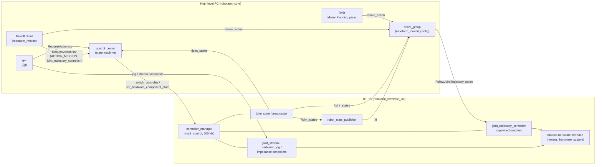

# robotarm_moveit_config

MoveIt 2 (ROS 2 Jazzy) configuration for the 6-axis robotarm: planning group, named poses,
collision matrix, inverse kinematics, joint/Cartesian limits, planning pipelines (OMPL, Pilz), and
how trajectories are sent to ros2_control. Also contains a standalone demo with simulated hardware.

The package has the same layout as a package generated by the MoveIt Setup Assistant, so you can
open and edit it with the Setup Assistant (see [section 5](#5-collision-matrix-and-setup-assistant)).

Contents

1. [Purpose and architecture](#1-purpose-and-architecture)
2. [File overview](#2-file-overview)
3. [Design decisions](#3-design-decisions)
4. [Quickstart](#4-quickstart)
5. [Collision matrix and Setup Assistant](#5-collision-matrix-and-setup-assistant)
6. [Using our own IK](#6-using-our-own-ik)
7. [Open issues / required changes outside this package](#7-open-issues--required-changes-outside-this-package)
8. [Known limitations and pitfalls](#8-known-limitations-and-pitfalls)
9. [Verification log](#9-verification-log)

---

## 1. Purpose and architecture

MoveIt is a motion planning framework. Given a goal (a named pose, joint values, or a TCP pose),
it computes a collision-free, time-parameterized **joint trajectory** that respects the joint
limits. MoveIt does not control motors itself. It hands the finished trajectory to a
**controller** (here the ros2_control `joint_trajectory_controller`), which interpolates it in the
real-time loop and commands the hardware.

The central MoveIt process is **`move_group`**. It holds the robot model (URDF + SRDF), the planning
scene (robot + obstacles), the IK solver and the planners, and offers ROS actions/services such as
`/move_action` (plan and/or execute), `/execute_trajectory` and `/compute_ik`, `/compute_fk`.
The RViz **MotionPlanning** panel and scripts are just clients of `move_group`.

This package only contains **configuration and launch files** for `move_group`.



Responsibilities:

| Component | Runs on | Responsibility |
|---|---|---|
| ros2_control (`controller_manager`, controllers, moteus hardware interface) | RT PC | real-time loop, interpolation, motor commands, `/joint_states` |
| `control_center` | high-level PC | system state machine (IDLE → CONNECTED → ARMED → MISSION), arms the hardware, **activates/deactivates controllers** |
| `move_group` (this package) | high-level PC | planning; sends trajectories to `joint_trajectory_controller` **while it is active** |
| `gui` | high-level PC | operator UI: joint stream and Cartesian jogging, compliant (impedance) modes |

Typical flow for a MoveIt motion on the real robot: the client asks `control_center` for a
mission with `controller_names = ["joint_trajectory_controller"]`, control_center activates that
controller, the client sends goals to `move_group`, and at the end it stops the mission (the
controller is deactivated again). [`robotarm_motion`](../robotarm_motion/README.md) implements this
handshake (`ControlCenterMission`), including what happens on STOP.

For development without the robot, `launch/demo.launch.py` starts everything from the RT PC column
(except the moteus hardware) locally with mock hardware.

---

## 2. File overview

```
robotarm_moveit_config/
├── .setup_assistant              where the URDF and SRDF are (read by Setup Assistant and MoveItConfigsBuilder)
├── CMakeLists.txt                installs config/, launch/, .setup_assistant
├── package.xml                   all runtime dependencies (rosdep)
├── README.md                     this file
├── config/
│   ├── robotarm.srdf             planning group, named poses, disabled collision pairs
│   ├── kinematics.yaml           IK solver (pick_ik)
│   ├── joint_limits.yaml         velocity/acceleration limits (PRELIMINARY)
│   ├── pilz_cartesian_limits.yaml  TCP limits for Pilz LIN/CIRC (PRELIMINARY)
│   ├── ompl_planning.yaml        OMPL pipeline
│   ├── pilz_industrial_motion_planner_planning.yaml  Pilz pipeline
│   ├── moveit_controllers.yaml   which controller MoveIt sends trajectories to
│   ├── ros2_controllers.yaml     ros2_control config, DEMO ONLY
│   └── moveit.rviz               RViz layout with MotionPlanning panel
├── launch/
│   ├── demo.launch.py            standalone demo with mock hardware
│   ├── move_group.launch.py      move_group (+ RViz) only, for the real robot
│   └── setup_assistant.launch.py opens this package in the Setup Assistant
└── doc/
    └── firmware_joint_trajectory_controller.md  patch for robotarm_firmware_lnx (see section 7)
```

The test script `demo_motions` and the Python MoveIt client are in the package
[`robotarm_motion`](../robotarm_motion/README.md); this package contains configuration only.

### `.setup_assistant`

A small YAML file. It says which URDF the config belongs to (`robotarm_description`,
`urdf/robotarm.urdf.xacro`, xacro arguments `use_hardware:=false tool:=axis_triad`) and where the SRDF is.
`MoveItConfigsBuilder` reads it to find the URDF, so no URDF copy exists in this package.
*Adjust:* only if the URDF moves or needs other xacro arguments.

### `config/robotarm.srdf`

The **Semantic Robot Description Format** adds to the URDF what MoveIt needs beyond geometry:

- **Planning group `arm`**: chain `base → tcp`, i.e. joints `axis1..axis6`. The tip link of the
  chain (`tcp`) is the link that is moved to pose goals and that carries the interactive marker in RViz.
  In the URDF the chain is `base → stage1 … stage6 → flange → <tool> → tcp`; the tool selected with
  the xacro argument `tool` defines where `tcp` is. Default here is `axis_triad` (tcp 0.118 m in
  front of the flange), the same as in the firmware mock and hardware launch files; `none` puts
  the tcp on the flange.
- **Named states** (`group_state`), usable by name from RViz ("Goal State" dropdown) and code:
  - `home`: all joints 0. The arm is stretched horizontally forward, at the edge of the workspace
    (fully stretched = singular).
  - `ready`: `0, -1.3, 1.5, 0, 1.0, 0`. The arm is bent, TCP (with `axis_triad`) in front of the
    robot at about x = 0.45 m, z = 0.36 m. `axis5 = 1.0` keeps the wrist away from the singularity at `axis5 = 0`
    (axes 4 and 6 aligned), where IK and Cartesian motions become ill-conditioned. Good start pose
    for Cartesian motions.
- **No virtual joint**: `base` is the root of the URDF and the fixed planning frame. (A virtual
  joint would only be needed if the robot were mounted on something moving or had to be placed
  in a `world` frame.)
- **`disable_collisions`**: link pairs that are never checked for self-collision. `Adjacent` =
  connected by a joint (always touching), `Never` = found collision-free in 100 000 random
  configurations, `Default` = already touching in the zero pose (here the tool body and `stage5`).
  Fewer pairs to check = faster planning. Generated automatically for the default tool
  `axis_triad`, see section 5. With `tool:=none` MoveIt warns once that `axis_triad_body` is
  unknown and ignores those pairs; other tools need a regenerated matrix.

*Adjust:* add named states; regenerate the collision matrix whenever the URDF geometry or joint
limits change.

### `config/kinematics.yaml`

IK solver for the group `arm`: **pick_ik** (`pick_ik/PickIkPlugin`) in `global` mode, with tight
thresholds (0.1 mm, 0.001 rad) because Pilz LIN solves IK for every point on the line.
The file also documents the KDL fallback and how to plug in our own IK (section 6).
*Adjust:* `kinematics_solver_timeout`, `mode` (`local` for servoing), thresholds, cost weights.

### `config/joint_limits.yaml` — PRELIMINARY

Velocity and acceleration limits per joint, used for time parameterization (OMPL pipeline) and by
Pilz. Position limits come from the URDF.

| Joints | max_velocity | max_acceleration |
|---|---|---|
| axis1..3 | 0.8 rad/s | 1.5 rad/s² |
| axis4..6 | 1.0 rad/s | 2.0 rad/s² |

`default_velocity_scaling_factor` / `default_acceleration_scaling_factor` = 0.1: requests that do
not specify a scaling (e.g. RViz with sliders left at the default) run at 10 % of these limits.
*Adjust:* after measuring on hardware. The velocity may not exceed the URDF `velocity` (currently
2.5–3.14 rad/s), otherwise Pilz does not start.

### `config/pilz_cartesian_limits.yaml` — PRELIMINARY

TCP limits for Pilz LIN/CIRC: 0.1 m/s, 0.25 m/s² (acc/dec), 0.5 rad/s. The Setup Assistant
defaults (1 m/s, 2.25 m/s², 1.57 rad/s) are far too fast for a first test.

### `config/ompl_planning.yaml`

OMPL pipeline: planner plugin, request/response adapters, and the group section for `arm`
(default planner `RRTConnect`; `RRTstar`, `PRM`, `BiTRRT` selectable in RViz). The parameters of all
OMPL planners come from `moveit_configs_utils/default_configs/ompl_defaults.yaml` (merged
automatically because this file has no top-level `planner_configs`).
*Adjust:* `longest_valid_segment_fraction` (collision check resolution), planner list.

### `config/pilz_industrial_motion_planner_planning.yaml`

Pilz pipeline (PTP, LIN, CIRC) and the sequence capabilities (`/sequence_move_group` action for
blended motion sequences). Same as the `moveit_configs_utils` default; kept here for visibility.

### `config/moveit_controllers.yaml`

`moveit_simple_controller_manager` with one `FollowJointTrajectory` controller
`joint_trajectory_controller` (action `/joint_trajectory_controller/follow_joint_trajectory`,
joints `axis1..6`), plus execution monitoring tolerances (`trajectory_execution.*`).
*Adjust:* controller name must equal the name in ros2_control (demo and firmware).

### `config/ros2_controllers.yaml` — demo only

ros2_control configuration for `demo.launch.py`: `controller_manager` at 500 Hz with
`joint_state_broadcaster` and `joint_trajectory_controller` (command: position + velocity,
state: position + velocity). **Not used on the real robot**; the RT PC has its own configuration.

### `config/moveit.rviz`

RViz layout: MotionPlanning display (planning group `arm`, goal marker enabled), grid, fixed frame
`base`.

### `launch/demo.launch.py`

Standalone demo: `robot_state_publisher`, `ros2_control_node` with **mock hardware**
(`mock_components/GenericSystem`, selected by `use_hardware:=false` in the URDF), spawners for
`joint_state_broadcaster` and `joint_trajectory_controller` (both active), and
`move_group.launch.py`. Argument `rviz:=true|false`.

### `launch/move_group.launch.py`

Only `move_group` (+ RViz, `rviz:=true|false`, default `true`; `tool:=<name>`, default
`axis_triad`, must match the tool on the RT PC; `use_sim_time:=true` with the MuJoCo sim;
`allow_trajectory_execution:=false` makes move_group plan only, as `launch_robot.py` does for the
execution gate). Starts **no** controller_manager and
**no** robot_state_publisher; use it against the real ros2_control stack. `robot_bringup`'s
`launch_robot.py` includes it (argument `moveit:=true`, the default). Here all MoveIt
parameters are assembled with `MoveItConfigsBuilder`, including `moveit_manage_controllers=False`
and the two planning pipelines (default: OMPL).

### `launch/setup_assistant.launch.py`

Opens the *installed* copy of this package in the Setup Assistant (standard file generated by the
Setup Assistant). To edit the package, open the source directory instead (section 5).

---

## 3. Design decisions

### OMPL and Pilz

- **OMPL** (default in RViz) is a collection of *sampling-based* planners. It finds collision-free
  paths around obstacles, but the path is random (different on each run) and not straight in
  Cartesian space. Use it for "get from A to B somehow, avoid obstacles".
- **Pilz industrial motion planner** creates *analytic* motions as known from industrial robot
  programming: `PTP` (all axes synchronized in joint space), `LIN` (straight TCP line), `CIRC`
  (TCP arc). They are deterministic and predictable, and the velocity profile is trapezoidal. Pilz
  does **not** plan around obstacles; it only rejects a colliding trajectory. Use it for
  programmed, repeatable motions (pick and place approach/retreat, process paths).

Both are loaded in one `move_group`; each request chooses one with `pipeline_id` and `planner_id`.

### pick_ik as IK solver

- KDL, the classic default, is a simple Newton-Raphson solver. It often fails far from the seed,
  and it has no cost terms.
- pick_ik solves the same problem numerically, with better success rates, and has a global mode (evolutionary search)
  and optional costs (stay close to the current state, avoid joint limits). It works for any chain
  without code generation (unlike IKFast), so it also works while the geometry still changes.
- Later our analytic IK (`robotarm_rbd`) can replace it with one line in `kinematics.yaml` (section 6).

### Conservative limits

The URDF has no acceleration limits (and its velocity limits of 2.5–3.14 rad/s are the motor
limits, not tested motion limits). The limits here are well below
what the TeleopController uses (3 rad/s, 4 rad/s²), and the default scaling is 10 %. MoveIt
trajectories can be long, fast, and far from where the operator expects, so the first tests on
hardware should be slow. Raise the values step by step after measuring.

### `moveit_simple_controller_manager` instead of `moveit_ros_control_interface`

MoveIt can use `moveit_ros_control_interface/Ros2ControlManager`, which activates and deactivates
ros2_control controllers **by itself** whenever it needs one. In our system, controller switching
belongs to `control_center`. It enforces the state machine: the hardware must be armed, and only one
mission may be active. It also deactivates controllers on STOP/ERROR. If MoveIt switched controllers
as well, it could activate a controller behind control_center's back, for example after a STOP.
Therefore:

- `moveit_simple_controller_manager` only knows the name of the action server; it never calls
  `switch_controller`.
- `moveit_manage_controllers=False` in `move_group.launch.py` makes this explicit.
- If `joint_trajectory_controller` is not active, the action goal is rejected and MoveIt reports
  the execution as failed. Nothing moves.

### Own demo mock instead of the firmware mock

`robotarm_firmware_lnx` also has a mock setup (`robotarm_mock.launch.py`), and since it got a
`joint_trajectory_controller` it is the most realistic test: same controller configuration as the
real robot, hardware starts inactive, and the controller has to be activated by control_center
(section 4, "Full system"). The demo here is still useful because it needs only this repository and
nothing else: the controller is always active, and no control_center or arming is needed. It is
meant for trying out MoveIt itself (planners, limits, RViz).

---

## 4. Quickstart

### Install dependencies (once per container)

```bash
sudo apt update
sudo apt install ros-jazzy-moveit ros-jazzy-pick-ik ros-jazzy-ros2-controllers
# or, equivalently, from package.xml:
rosdep update
rosdep install --from-paths src/robotarm_moveit_config --ignore-src -y
```

(The devcontainer Dockerfile already installs these packages; the commands are only needed in an
older container or outside the devcontainer. In the devcontainer you are root, so `sudo` is not needed.)

### Build

```bash
cd /robotarm_core
source /opt/ros/jazzy/setup.bash
colcon build --packages-up-to robotarm_moveit_config
source install/setup.bash
```

### Start the demo

```bash
ros2 launch robotarm_moveit_config demo.launch.py            # with RViz
ros2 launch robotarm_moveit_config demo.launch.py rviz:=false  # headless
```

Wait for `You can start planning now!` in the output. Quick checks in a second terminal:

```bash
ros2 control list_controllers      # both controllers "active"
ros2 topic hz /joint_states        # ~500 Hz
ros2 run robotarm_motion demo_motions   # runs the test motions (a)-(c), see robotarm_motion
```

### Plan and execute in RViz

1. In the **MotionPlanning** panel, tab **Planning**: "Planning Group" is `arm`.
2. Set a goal:
   - either drag the **interactive marker** at the TCP (arrows = translate, rings = rotate).
     The orange robot shows the goal state; it turns red if the IK has no solution or the pose collides.
   - or choose a named state in **Goal State** (e.g. `ready`) and click **Update**.
3. Set **Velocity Scaling** / **Accel. Scaling** (e.g. 0.5 for the demo).
4. Click **Plan**. The planned trajectory is animated (enable "Show Trail" under
   Displays → MotionPlanning → Planned Path to see the whole path).
5. Click **Execute** (or **Plan & Execute**). The grey robot (actual state from `/joint_states`) moves.

Try other planners in the **Context** tab (top part of the panel):

- "Planning library": `ompl` → choose `RRTConnect`, `RRTstar`, ...
- "Planning library": `pilz_industrial_motion_planner` → choose `PTP` or `LIN`. Put the goal a few
  centimetres from the current TCP pose. With `LIN` the TCP then moves on a straight line.
  (`CIRC` needs an extra path constraint, which cannot be set in the panel.)

### Full system: start everything (mock, MuJoCo sim or real robot)

This is the setup used on the real robot: RT side from `robotarm_firmware_lnx`, control_center,
MoveIt, motion_server, GUI and RViz from this repository. With the firmware mock or the MuJoCo sim
everything runs on one machine. **Never start two RT sides at the same time** (mock, sim, real
robot or `demo.launch.py`): each one provides `/controller_manager` and `/joint_states`.

#### 0. Once: prepare both workspaces

The firmware needs the `joint_trajectory_controller` (section 7). Until it is merged upstream, use
the branch `feature/joint-trajectory-controller` (fork `saw2812/robotarm_firmware_lnx`, or apply
the patch in [`doc/`](doc/firmware_joint_trajectory_controller.md)):

```bash
# RT side (container or RT PC)
cd <robotarm_firmware_lnx>
git remote add fork https://github.com/saw2812/robotarm_firmware_lnx.git   # once
git fetch fork
git checkout -b feature/joint-trajectory-controller fork/feature/joint-trajectory-controller
git -c url."https://github.com/".insteadOf="git@github.com:" submodule update --init
source /opt/ros/jazzy/setup.bash
rosdep install --from-paths src --ignore-src -y -r
colcon build

# high-level side (this repository)
cd /robotarm_core
source /opt/ros/jazzy/setup.bash
rosdep install --from-paths src --ignore-src -y -r
colcon build
source install/setup.bash
ros2 run robotarm_motion motion init     # goals file ~/.ros/robotarm_motion/goals.yaml from the example
```

After a `git pull` in either repository: `colcon build` again.

#### 1. Start the RT side (terminal 1), one of

```bash
cd <robotarm_firmware_lnx> && source install/setup.bash
ros2 launch robotarm_bringup robotarm_mock.launch.py tool:=axis_triad   # A: mock joints
ros2 launch robotarm_mujoco sim.launch.py tool:=axis_triad              # B: MuJoCo physics sim (viewer window)
ros2 launch robotarm_bringup robotarm_hardware.launch.py tool:=none     # C: real robot (RT PC)
```

Wait until the controllers are loaded (`ros2 control list_controllers` in another terminal shows
`joint_trajectory_controller ... inactive`).

#### 2. Start the high-level side (terminal 2)

```bash
cd /robotarm_core && source install/setup.bash
ros2 launch robot_bringup launch_robot.py tool:=axis_triad                    # A: mock
ros2 launch robot_bringup launch_robot.py tool:=axis_triad use_sim_time:=true # B: MuJoCo sim
ros2 launch robot_bringup launch_robot.py tool:=none                          # C: real robot
#   further options: moveit:=false  rviz:=false  gui:=false  execution_gate:=false
```

This starts control_center, move_group (plans only), the motion_server (executes), the GUI and
RViz. If the windows do not appear ("Authorization required"), run `xhost +local:` on the host
(not in the container) and start again.

**The tool must be the same on both sides** (the `tool` of the URDF defines where the tcp is):

| Launch file | Default `tool` |
|---|---|
| firmware `robotarm_mock.launch.py` | `axis_triad` |
| firmware `robotarm_hardware.launch.py` | `none` (no tool mounted on the real arm) |
| firmware `robotarm_mujoco` `sim.launch.py` | `none` |
| this repository: `launch_robot.py`, `move_group.launch.py`, `demo.launch.py` | `axis_triad` |

Pass it explicitly on both sides, as above, with the tool that is actually mounted. A mismatch puts
MoveIt's tcp 0.118 m away from the real one and gives it a wrong collision model.

In the MuJoCo sim the arm falls limp onto its joint limits until a controller holds it; the
trajectory controller holds the current pose as soon as a job's mission activates it. Position and
velocity are followed by a generic sim PID there, not by a model of the moteus position loop.

#### 3. Real robot only: before the first motion

- **Network**: RT PC and high-level PC in the same network, same `ROS_DOMAIN_ID` (default 0) and
  `RMW_IMPLEMENTATION=rmw_cyclonedds_cpp` on both (the Dockerfiles set it), containers with
  `--network=host`. On the high-level PC `ros2 node list` must show `/controller_manager`.
- **Clocks**: synchronize both PCs (NTP/chrony). MoveIt compares the `/joint_states` stamps of the
  RT PC with its own clock; more than about a second apart and it treats the robot state as
  outdated ("Failed to fetch current robot state"), execution fails. Quick check: run
  `date +%s.%N` on both at the same time.
- **RT PC**: real-time setup and `/dev/fdcanusb` access as in the firmware's
  `docs/REALTIME_SETUP.md`.
- **Safety**: e-stop in reach, nobody in the working area, arm in a safe pose. Every job switches
  controllers on the RT PC (the trajectory controller is activated at the start and deactivated at
  the end); check with the firmware owner that these transitions are tested on the hardware.
  First motions small and slow (below), then raise speed and `joint_limits.yaml` step by step.

#### 4. Operate

Arm the robot: **ARM ROBOT** in the GUI header, or

```bash
ros2 service call /request_action robotarm_interface/srv/RequestAction \
  "{node_name: operator, action_id: 1, request_type: 254}"
```

**GUI**: page **MOVEIT** → choose a program (▶) or goal (●), for a goal the motion (PTP/LIN/OMPL),
the speed → **PLAN** (shown in RViz, nothing moves) → **EXECUTE**; **CANCEL** stops the job. Teach the
current pose under "Teach current pose".

**Command line** (terminal 3, `cd /robotarm_core && source install/setup.bash`):

```bash
ros2 run robotarm_motion motion list                          # goals (incl. home, ready) and programs
ros2 run robotarm_motion motion move ready --plan-only        # PTP (default) plan only, shown in RViz
ros2 run robotarm_motion motion move ready --scaling 0.1      # PTP to ready at 10 %
ros2 run robotarm_motion motion move left --motion LIN        # other motion types: LIN, OMPL
ros2 run robotarm_motion motion teach pose_a                  # current pose as joint goal
ros2 run robotarm_motion motion teach frame_a --cartesian     # current tcp pose (+ joints as seed)
ros2 run robotarm_motion motion run square --plan-only        # program: plan only
ros2 run robotarm_motion motion run square                    # program: plan everything, then execute
```

Own PTP goals and programs go into `~/.ros/robotarm_motion/goals.yaml` (read fresh for every job;
in the GUI ⟳ reloads it), e.g.

```yaml
goals:
  pose_a: {joints_deg: [30, -60, 80, 0, 45, 0]}   # axis1..axis6 [deg]
programs:
  my_ptp:
    - ready                                     # steps without "motion" are PTP
    - {goal: pose_a, blend: 0.05}               # passes pose_a within 5 cm without stopping
    - home
```

then `ros2 run robotarm_motion motion run my_ptp`. Format and options: `robotarm_motion` README.

**First motions on the real robot**: jog the arm (GUI page JOINT) to a free pose, `motion teach start`,
jog a few degrees away, `motion move start --plan-only`, check the path in RViz, then
`motion move start --scaling 0.1`.

**Stop**: **STOP** in the GUI header (the running job is aborted, the arm holds), **RESUME** to
continue; or

```bash
ros2 service call /request_action robotarm_interface/srv/RequestAction \
  "{node_name: operator, action_id: 11, request_type: 254}"   # STOP
ros2 service call /request_action robotarm_interface/srv/RequestAction \
  "{node_name: operator, action_id: 11, request_type: 255}"   # leave STOP
```

(`action_id`: 1 = ARM, 2 = MISSION, 11 = STOP, 12 = EMERGENCY; `request_type`: 254 = start,
255 = stop, see `robotarm_interface/srv/RequestAction.srv`.)

#### 5. Shut down

Close the GUI window, then Ctrl-C in terminal 2 (high-level side), then in terminal 1 (RT side).
move_group prints a segmentation fault on shutdown; that is known and harmless (section 8).

#### RViz Execute and missions by hand

Planning in RViz always works. By default (`execution_gate:=true`) move_group only **plans**:
RViz *Execute* and MoveGroup plan + execute do not move the robot (move_group logs "not allowed to
execute trajectories ... Only a motion plan will be computed" and reports SUCCESS for the plan).
Motions are executed by the `motion_server` of [`robotarm_motion`](../robotarm_motion/README.md),
the execution gate, which runs each job in its own control_center mission.

To execute from RViz anyway, start with `execution_gate:=false` (the gate is then off) and start a
mission by hand:

```bash
ros2 service call /request_action robotarm_interface/srv/RequestAction \
  "{node_name: rviz_user, action_id: 2, request_type: 254, controller_names: [joint_trajectory_controller]}"
# ... plan & execute in RViz ...
ros2 service call /request_action robotarm_interface/srv/RequestAction \
  "{node_name: rviz_user, action_id: 2, request_type: 255, controller_names: [joint_trajectory_controller]}"
```

`controller_names` is a list: control_center activates all of them in one switch request (the GUI
uses that for chained controllers, e.g. `[cartesian_impedance_controller,
joint_stream_controller_impedance]`). Only one mission can be active at a time, so while a GUI page
is engaged, no MoveIt mission can start (and vice versa).

---

## 5. Collision matrix and Setup Assistant

### Regenerating the collision matrix

The Setup Assistant contains a command line tool that samples random joint configurations and
computes which link pairs can be disabled. Run it whenever the URDF geometry or joint limits change:

```bash
cd /robotarm_core
colcon build --packages-up-to robotarm_moveit_config && source install/setup.bash
ros2 run moveit_setup_assistant collisions_updater \
  --urdf $(ros2 pkg prefix robotarm_description)/share/robotarm_description/urdf/robotarm.urdf.xacro \
  --xacro-args "use_hardware:=false tool:=axis_triad" \
  --srdf src/robotarm_moveit_config/config/robotarm.srdf \
  --output src/robotarm_moveit_config/config/robotarm.srdf \
  --default --trials 100000
```

- `--default` also disables pairs that already collide in the zero pose (none at the moment).
- Without `--keep`, all existing `disable_collisions` entries are replaced by the new result.
- The rest of the SRDF (groups, named states) is kept.
- Check the result with `git diff`. "Never" is a statistical result; if a pair can collide in a rare
  configuration, remove its line by hand.

(You may see a warning `Found remap rule 'use_hardware:=false'`; it comes from rcl parsing the xacro
argument and is harmless.)

The same can be done graphically in the Setup Assistant, page "Self-Collisions".

### Opening the package in the Setup Assistant

```bash
source install/setup.bash    # robotarm_description must be built
ros2 run moveit_setup_assistant moveit_setup_assistant \
  --config_pkg=/robotarm_core/src/robotarm_moveit_config
```

Pass the **source** directory. The standard `ros2 launch robotarm_moveit_config setup_assistant.launch.py`
also works for viewing, but it opens the *installed* copy in `install/`, so "Generate Package" would
write there and the changes would be lost on the next build.

The Setup Assistant reads `.setup_assistant`, loads the URDF from `robotarm_description` and the
SRDF, and opens with the package loaded. Things to know before clicking "Generate Package":

- **Page "ros2_control URDF Modification"**: do **not** add interfaces. Our URDF already has its
  own ros2_control block (`moteus_hardware_system`). Otherwise the Setup Assistant creates
  `config/robotarm.urdf.xacro` + `robotarm.ros2_control.xacro`, and `MoveItConfigsBuilder` would
  then load that file instead of the original URDF.
- **Page "Configuration Files"**: only select the files you changed. Uncheck
  `package.xml`, `CMakeLists.txt`, the launch files, `ros2_controllers.yaml` and
  `moveit_controllers.yaml`, otherwise our versions (comments, `moveit_manage_controllers`,
  pipelines) are overwritten with generic templates.
- The Setup Assistant rewrites the SRDF completely; custom XML comments in it are lost.
- Review everything with `git diff` afterwards.

---

## 6. Using our own IK

`robotarm_rbd` (in the `robotarm_description` repository) implements
`kinematics_interface::KinematicsInterface`. That is the **ros2_control** kinematics interface
(FK, Jacobian, used by controllers like admittance control), **not** the MoveIt IK interface. Its
closed-form IK is not implemented yet. To use it in MoveIt, write a small adapter plugin:

1. **Base class:** `kinematics::KinematicsBase` from `moveit_core`,
   header `<moveit/kinematics_base/kinematics_base.hpp>`.
2. **Methods to implement:**
   - `initialize(node, robot_model, group_name, base_frame, tip_frames, search_discretization)`.
     Read the chain from the `RobotModel`, create the `robotarm_rbd` model, and read parameters
     from `robot_description_kinematics.arm.*`.
   - `getPositionIK(...)`: one solution close to the seed state.
   - `searchPositionIK(...)` (several overloads, with timeout, consistency limits and a solution
     callback). This is the main call from MoveIt. With a closed-form IK: compute all (up to 8)
     solutions, drop those outside the joint limits or rejected by the callback (collision
     check), and return the one closest to the seed.
   - `getPositionFK(...)`.
   - `getJointNames()`, `getLinkNames()`.
   - Optional: `getPositionIK` with multiple solutions (`std::vector<std::vector<double>>`), which
     Pilz and Cartesian planning can use.
3. **Export with pluginlib:** `PLUGINLIB_EXPORT_CLASS(robotarm_rbd::MoveItKinematicsPlugin,
   kinematics::KinematicsBase)`, plus a plugin XML with `base_class_type="kinematics::KinematicsBase"`,
   registered with `pluginlib_export_plugin_description_file(moveit_core <xml>)`.
   Best as its own small package (e.g. `robotarm_moveit_ik`), so `robotarm_rbd` stays
   free of MoveIt dependencies.
4. **Switch** in `config/kinematics.yaml`:
   ```yaml
   arm:
     kinematics_solver: robotarm_rbd/MoveItKinematicsPlugin
     kinematics_solver_timeout: 0.005
   ```
   and add the package as `exec_depend` in `package.xml`.

Reference implementations: `kdl_kinematics_plugin` (moveit_kinematics) and pick_ik.

---

## 7. Open issues / required changes outside this package

### Done

1. **`joint_trajectory_controller` in `robotarm_firmware_lnx`**: branch
   `feature/joint-trajectory-controller` of the firmware repository (committed locally, merged with
   firmware `main` `705ac5d` of 2026-10-22; **not pushed**, see "Still open"):
   - `controllers.yaml`: `joint_trajectory_controller`, joints `axis1..axis6`, command `position`
     + `velocity`, state `position` + `velocity`, tracking tolerances (`constraints`, PRELIMINARY:
     0.1 rad while moving, 0.01 rad at the goal, 0.5 s goal time),
   - spawned `--inactive` from `controllers.launch.py`, which hardware, mock and the MuJoCo sim share,
   - `exec_depend` in `robotarm_bringup/package.xml`, README updated.
2. **Activation through `control_center`**: [`robotarm_motion`](../robotarm_motion/README.md)
   (`ControlCenterMission`) starts/stops the mission and cancels the MoveIt goal whenever
   control_center leaves MISSION on its own (STOP, ERROR, EMERGENCY, or `controller_lost` when the
   controller is deactivated by someone else). control_center allows only one mission at a time, so
   the jog/stream controllers and the trajectory controller (same command interfaces) are never
   active together. Verified with the firmware mock and the MuJoCo sim (section 9).
3. **Joint stream (former teleop) covers `axis1..axis6`** (done upstream).
4. **URDF**: `robotarm_description` `7afc51e` (here; the firmware pins the same) has real velocity
   (2.5–3.14 rad/s) and effort limits, the renamed links (`base`, `stage1..stage6`) and the tool
   `axis_triad`. SRDF, RViz config, collision matrix and `robotarm_motion` use the new names; MoveIt
   uses the same default tool as the RT PC (`tool:=` launch argument). Acceleration limits exist
   only in `joint_limits.yaml`.
5. **Dockerfile** installs `moveit`, `pick-ik`, `ros2-controllers`, `pinocchio` (robotarm_rbd
   tests) and `joint-state-publisher-gui`.
6. **Workspace build**: a plain `colcon build` of the whole workspace succeeds.
7. **`robot_bringup/launch/launch_robot.py`** starts `move_group.launch.py` (`moveit:=true`, default),
   with `rviz:=`, `gui:=` and `tool:=` arguments.
8. **Controller sets**: `RequestAction.controller_names` is a list since `robotarm_interface`
   `4aea864`; `ControlCenterMission` sends a list (`controllers=[...]`).
9. **Goals, programs and the execution gate** (`robotarm_motion`): goals file with joint and
   Cartesian goals (IK seed), programs (PTP/LIN/OMPL steps, blending, offsets, planned completely
   before anything moves), `motion` command line, and the `motion_server` as the only executor of
   MoveIt trajectories in `launch_robot.py` (`execution_gate:=true`).

### Still open

1. **First run on the real robot** (not possible here). Suggested order:
   - mock and MuJoCo sim first (section 4, "Full system"), then hardware with `--scaling 0.1` and
     the e-stop in hand,
   - check that the trajectory tolerances in the firmware `controllers.yaml` trigger (e.g. block a
     joint gently at low speed); mock and sim follow closely, so they were never triggered here,
   - compare `/joint_states` with the planned trajectory, then raise `joint_limits.yaml` step by step.
2. **Get the firmware branch into the firmware repository**: the GitHub account used here has no
   write access to `robotarm_firmware_lnx`. The complete change is therefore stored as a patch with
   apply instructions in [`doc/firmware_joint_trajectory_controller.md`](doc/firmware_joint_trajectory_controller.md)
   (base: firmware `705ac5d`, verified to apply cleanly). Apply it there, or open a pull request
   after getting collaborator access or forking the repository.
3. **GUI**: the operator GUI has a MOVEIT page (plan/execute goals and programs, teach) on top of
   the `motion_server` (see `robotarm_motion` README, "GUI: MOVEIT page").
4. **Remaining gap of the execution gate**: move_group can no longer execute, but a node that
   sends `FollowJointTrajectory` goals directly to the controller while the motion_server's mission
   keeps it active would still move the arm, and during a jog mission any node publishing to the
   jog topics moves it. Closing that needs access control on the ROS network (SROS2).
5. **control_center is not enforced**: `ros2 control switch_controllers` bypasses it. The
   controller manager still prevents two controllers on the same interfaces, but control_center
   only notices a lost controller during a mission, not one activated while ARMED.
6. **Tool selection**: the defaults differ (firmware hardware and sim: `none`, firmware mock and this
   repository: `axis_triad`, see section 4 "Full system"). Always pass the mounted `tool` on both
   sides. With another tool, regenerate the collision matrix.
7. **`/joint_states` rate on the RT PC is 50 Hz** (`joint_state_broadcaster.publish_rate`), the demo
   uses 500 Hz. Fine for MoveIt; control_center's watchdog triggers after 0.5 s without a message.

### Other findings

1. **robotarm_interface**:
   - `CMakeLists.txt` only generates `RequestAction.srv`, `SystemStatus.msg`,
     `CartesianIncrement.msg` and `SetFloat64.srv`. The messages `AxisData`, `MotorParameter`,
     `TrajectoryFrame` and all actions (`Mission`, `PlanCSV`, `PlanJointSpace`, `ConfigMotor`,
     `ReadMotorConfigs`) are not built. Actions would also need `action_msgs` as a dependency.
   - `PlanJointSpace.action` uses a type `JointAngles` that does not exist.
2. ~~**Wrong/missing dependencies in package.xml files**~~: fixed upstream (2026-10); `rosdep install
   --from-paths src` works for the whole workspace.
3. ~~**GUI speed service name**~~: fixed upstream; `joint_jog_widget.py` now uses
   `/<joint stream controller>/scale_speed` in client and warning.
4. **`rviz.launch.py`**: exists in `robotarm_description/launch/` and is included by
   `robot_bringup/launch/launch_robot.py`. It was reported as missing, but it is present in this
   repository. If a launch file in the firmware repo refers to it, check the path there.
5. **KDL warning about root inertia**: `robot_state_publisher` warns
   `The root link base has an inertia specified in the URDF, but KDL does not support a root link with an inertia`.
   Harmless for MoveIt; it goes away if the inertia of `base` is removed or a dummy root link is added.

---

## 8. Known limitations and pitfalls

- **Never run the demo in parallel with the firmware mock or the real robot** (same ROS domain).
  Both provide `/controller_manager`, `/joint_states`, `/robot_description` and `/tf`. MoveIt then sees
  two robots with jumping joint states, and `control_center` may switch controllers in the wrong
  controller_manager. Use a different `ROS_DOMAIN_ID` if you really need both.
- **Mock hardware is perfect**: `GenericSystem` copies commands to states. Tracking errors, torque
  limits, and dynamics are not simulated. A trajectory that runs in the demo can still fail on hardware.
- **No obstacles**: the planning scene only contains the robot (self-collision). Table, walls and
  cables are unknown to MoveIt. Add them as collision objects (RViz "Scene Objects" tab or
  `/apply_planning_scene`) before using OMPL near real obstacles. Pilz ignores obstacles unless
  the result collides.
- **Log messages at startup** that are expected and harmless:
  - `[occupancy_map_monitor]: No 3D sensor plugin(s) defined for octomap updates` (ERROR) and
    `Resolution not specified for Octomap` (WARN). There are no depth sensors configured.
  - The KDL root-inertia warning (section 7, "Other findings", item 5).
- **Collision matrix "Never" is statistical** (100 000 samples); see section 5.
- **Default scaling is 10 %.** RViz motions are slow on purpose; raise the sliders in the panel.
- **Pilz LIN near singularities / workspace boundary**: LIN through or near `axis5 = 0` (wrist
  singularity) or from the fully stretched `home` pose fails with `NO_IK_SOLUTION`. From `home`, a
  5 cm move up or down with the same tool orientation is simply out of reach (verified with
  `/compute_ik`). Start Cartesian motions from `ready`-like poses.
- **move_group crashes on shutdown**: pressing Ctrl-C prints a segmentation fault of `move_group`
  in `rclcpp::Executor::~Executor()`. This happens in the MoveIt 2.12.4 binary while it shuts down,
  after all planning has stopped. It does not come from this configuration and has no effect.
- **Multi-point paths**: Pilz sequences (`/sequence_move_group`) respect the Cartesian limits and can
  blend corners; `/compute_cartesian_path` only respects joint limits and ignores
  `max_cartesian_speed` (section 9, "Multi-point paths").
- **pick_ik `global` mode** can jump to a different IK branch when you drag the marker (e.g.
  flip the wrist). Increase `minimal_displacement_weight` in `kinematics.yaml` if this is annoying.
- **Changing the URDF**: after changing link names, joint names or limits, update the SRDF,
  `joint_limits.yaml`, `moveit_controllers.yaml`, `ros2_controllers.yaml`, and regenerate the
  collision matrix.
- **`use_hardware` in `move_group.launch.py`**: the URDF is loaded with `use_hardware:=false`. This
  only changes the ros2_control plugin tag, which move_group ignores, so it is correct for the
  real robot too. `tool` is different: it moves the `tcp` (and adds the tool to the collision
  model), so it must match the tool on the RT PC. The defaults differ between the launch files
  (table in section 4, "Full system"); pass `tool:=` explicitly on both sides.
- **A joint resting on its limit blocks planning**: MoveIt refuses a start state outside the
  joint limits (`START_STATE_INVALID`, "outside bounds"), even by 0.0005 rad. In the MuJoCo sim the
  limp arm rests on axis2's upper limit; the real arm can rest on a mechanical stop after power-up.
  `robotarm_motion` clamps a start state that is at most 0.01 rad outside onto the limit, plans
  from it and executes the planned trajectory (move_group's start tolerance accepts it). RViz
  cannot do that: jog the joint off its limit first. (`fix_start_state` of `CheckStartStateBounds`
  does not help, it only wraps continuous joints.)
- **RViz Execute on the real robot needs a mission** (section 4, "Full system"). Without one, the
  goal is rejected by the inactive controller and nothing moves.

---

## 9. Verification log

Environment: devcontainer, ROS 2 Jazzy, MoveIt 2.12.4, pick_ik, ros2_controllers from apt,
`RMW_IMPLEMENTATION=rmw_cyclonedds_cpp`.

The first part is the initial verification when the package was created (2026-09-29,
`robotarm_description` `1265c65`; the test script was still `scripts/demo_motions.py` in this
package, now `ros2 run robotarm_motion demo_motions`). The last part,
["Integration test with the firmware mock"](#integration-test-with-the-firmware-mock-2026-10-04),
is the end-to-end test.

### Build

```bash
colcon build --packages-up-to robotarm_moveit_config
rosdep check --from-paths src/robotarm_moveit_config --ignore-src
ament_flake8 --linelength 100 src/robotarm_moveit_config
```

Result: clean build of `robotarm_description` + `robotarm_moveit_config`, **no warnings**;
`All system dependencies have been satisfied`; flake8 without findings.

### URDF

`xacro robotarm.urdf.xacro use_hardware:=false` expands without errors; `check_urdf`: serial chain
`Base_1 → Shoulder_1 → Elbow_1 → Forearm_1 → Stage4_1 → Stage5_1 → Stage6_1 → tcp`; all 119
`package://` mesh references resolve.

### Headless demo

```bash
ros2 launch robotarm_moveit_config demo.launch.py rviz:=false
ros2 control list_controllers
ros2 control list_hardware_components
ros2 topic hz /joint_states
```

| Check | Result |
|---|---|
| move_group | `You can start planning now!`; OMPL and Pilz (PTP, LIN, CIRC) loaded; `Added FollowJointTrajectory controller for joint_trajectory_controller`; `Trajectory execution is not managing controllers` |
| controllers | `joint_state_broadcaster` and `joint_trajectory_controller` **active** |
| hardware | `moteus_hardware_system`, plugin `mock_components/GenericSystem`, active, 500 Hz; JTC claims `position` + `velocity` of axis1..6 |
| `/joint_states` | ~500 Hz, joints `axis1..axis6` |
| warnings/errors in log | only the expected ones listed in section 8 |

### Test motions

```bash
ros2 run robotarm_motion demo_motions                # (a), (b), (c) plan only
ros2 run robotarm_motion demo_motions --execute-lin  # (c) also executed
```

Scaling 0.5 (velocity and acceleration):

| Motion | Result | Duration | Check |
|---|---|---|---|
| (a) OMPL RRTConnect → `ready`, executed | SUCCESS | 4.28 s | goal reached (error 7e-5 rad, OMPL goal tolerance 1e-4); peak velocity exactly 100 % of 0.5 × limit |
| (b) Pilz PTP → `home`, executed | SUCCESS | 4.28 s | goal reached (error 1e-16 rad); peak velocity 100 % of 0.5 × limit |
| (c) Pilz LIN +5 cm z from `ready`, plan only | SUCCESS, 0.03 s planning | 1.40 s | TCP z 0.4658 → 0.5157 m (5.00 cm), max. deviation from straight line 0.046 mm |
| (c) with `--execute-lin` | SUCCESS | 1.40 s | same geometry, then PTP → `home` SUCCESS |

The durations match the configured limits. Axis3 moves 1.5 rad at 0.5 × 0.8 = 0.4 rad/s with
0.5 × 1.5 = 0.75 rad/s², giving 1.5/0.4 + 0.4/0.75 = 4.28 s. LIN: 5 cm at 0.5 × 0.1 = 0.05 m/s with
0.125 m/s², giving 1.0 + 0.4 = 1.40 s.

The first run with the pick_ik default thresholds (1 mm) gave a LIN of only 4.92 cm with 0.32 mm deviation.
That is why `kinematics.yaml` uses 0.1 mm / 0.001 rad.

Negative tests:

| Test | Result |
|---|---|
| `ros2 control set_controller_state joint_trajectory_controller inactive`, then execute PTP → `ready` | `CONTROL_FAILED`; JTC: `Can't accept new action goals. Controller is not running.`; no joint moved |
| Pilz LIN ±5 cm z from `home` | `NO_IK_SOLUTION` (out of reach, confirmed with `/compute_ik` for two seeds) |

### Demo with RViz

`ros2 launch robotarm_moveit_config demo.launch.py`: RViz starts. MotionPlanning display:
`Ready to take commands for planning group arm`, interactive markers connected. No plugin load
errors. The only messages are the harmless ones:
- `Action server: /recognize_objects not available` (ERROR; no object recognition is used)
- class_loader `namespace collision ... InteractiveMarkerDisplay` (upstream MoveIt/RViz linking issue)
- `Publisher already registered for node name: 'rviz2'`
- the KDL root inertia warning

The test script was run once more with RViz open; no new warnings from RViz. The visual
check (marker, planning, execution in the GUI) is still open.

### Setup Assistant

`moveit_setup_assistant --config_pkg=<src or install path>`: URDF and SRDF load without errors
(`Robot semantic model successfully loaded`). Generating the package from the Setup Assistant
was not tested.

### Collision matrix

`collisions_updater ... --default --trials 100000` (command in section 5): 6 `Adjacent` + 4 `Never`
pairs; no pair collides in the zero pose.

### Integration test with the firmware mock (2026-10-04)

Setup:
- `robotarm_description` `8ab90ac` in both repositories,
- `robotarm_firmware_lnx` branch `feature/joint-trajectory-controller`, built in
  `/ros2_ws/robotarm_firmware_lnx`,
- this repository with `robotarm_motion` and the updated `robot_bringup`.

```bash
# firmware workspace
ros2 launch robotarm_bringup robotarm_mock.launch.py
# this workspace
ros2 launch robot_bringup launch_robot.py gui:=false rviz:=false
ros2 run robotarm_motion demo_motions --mission ...
```

| # | Test | Result |
|---|---|---|
| 0 | Startup | Firmware: hardware `inactive`; `joint_trajectory_controller` and `teleop_controller` `inactive`. control_center: `CONNECTED`. move_group: `You can start planning now!` |
| 1 | `demo_motions --mission` while only CONNECTED | refused: `control_center is CONNECTED, arm the robot first`; no controller activated |
| 2 | `demo_motions --mission --arm --execute-lin` | armed → mission started (JTC active) → (a) OMPL, (b) PTP, (c) PTP + LIN + PTP all SUCCESS, same durations as in the demo; LIN 5.00 cm, 0.068 mm deviation → mission stopped (JTC inactive), control_center `ARMED` |
| 3 | STOP during (a) at scaling 0.1 (`RequestAction` INVOKE_STOP after ~9 s) | control_center `STOP`, JTC deactivated; JTC log `Current goal cancelled during deactivate transition`, MoveIt `ABORTED`; client: `MissionAborted: control_center switched to STOP`; joints frozen mid-motion (identical `/joint_states` 2 s and 5 s after the STOP) |
| 4 | `exit_stop`, then teleop mission (`controller_names: teleop_controller`) | `ARMED` → teleop active, JTC inactive; a 6-value command on `/teleop_controller/commands` moves all 6 axes; mission stop → `ARMED` |
| 5 | new `demo_motions --mission` from the teleop pose | all checks passed |
| 6 | `launch_robot.py` arguments | `moveit:=false rviz:=false` → control_center only; `moveit:=false rviz:=true` → + plain RViz; `moveit:=true rviz:=false` → + move_group |

Also re-run with `8ab90ac`: the standalone demo (`demo_motions --execute-lin`, all checks passed);
the collision matrix (identical); the URDF (`… → Stage6_1 → flange → tcp`, all meshes resolve). Also
re-run: `colcon build` of the whole workspace (9 packages, OK), `colcon test --packages-select
robotarm_motion` (flake8 + pep257, 2/2 passed), and a clean shutdown of `launch_robot.py` on Ctrl-C
(apart from the known move_group segfault).

### Multi-point paths (2026-10-04)

Path: a 5 cm square in the y-z plane of `Base_1`, starting at the TCP of `ready`, with constant
tool orientation, scaling 0.5. Each method ran on the standalone demo and on the firmware mock
inside a control_center mission; the results were the same. The values are measured on the
**executed** path: `/joint_states` recorded during execution, resampled at 100 Hz, FK via
`/compute_fk`.

| Method | Result | Motion time | Peak TCP speed | Corners | Max deviation from square |
|---|---|---|---|---|---|
| Pilz sequence (`/sequence_move_group`), 4 × LIN, `blend_radius` 0 | SUCCESS | 5.60 s | 53 mm/s | **stops** at every corner (< 1.1 mm/s) | 0.14 mm |
| Pilz sequence, 4 × LIN, `blend_radius` 10 mm | SUCCESS | 4.50 s | 58 mm/s | **passes** at 20–28 mm/s, rounded (closest 0.9–1.9 mm) | 1.36 mm in the blend zones, ≤ 0.22 mm elsewhere |
| `/compute_cartesian_path` (2 mm steps) + `/execute_trajectory` | SUCCESS, fraction 1.0 | 3.68 s | 112 mm/s | passes at 12–14 mm/s (corner cut 0.35–0.43 mm) | 0.29 mm |
| same with `max_cartesian_speed` 30 mm/s | SUCCESS, fraction 1.0 | 3.70 s | 111 mm/s | same | 0.27 mm |

In all runs the orientation stayed within 0.02°, the arm ended < 0.1 mm from the start corner,
and joint velocities stayed ≤ 94 % of scaling × `joint_limits.yaml`.

What this shows:
- **Pilz sequences** follow the Cartesian limits (`pilz_cartesian_limits.yaml`, 0.1 m/s × scaling
  = 50 mm/s). The measured peaks are 5–16 % above that, the most in the blend zones.
  `blend_radius` > 0 turns the corners into smooth arcs without stopping; 0 stops at each point.
- **Blending rules**: the last item must have `blend_radius` 0. Blend spheres of consecutive points
  must not overlap (4 × 50 mm segments with 40 mm radius → `INVALID_MOTION_PLAN`). Mixed PTP → LIN
  blending is accepted.
- **`/compute_cartesian_path`** is timed only by the joint limits (TOTG), so the TCP gets about 2×
  faster than with Pilz. The corners are slightly rounded in joint space (no stop). The request field
  `max_cartesian_speed` is **ignored** by the move_group service in MoveIt 2.12.4 (no effect measured;
  the capability library does not use the Cartesian speed limiter). Limit the speed with
  `max_velocity_scaling_factor` instead.

### After merging upstream `main` (2026-10-10)

Both feature branches were merged with the current `main` of their repositories:
- robotarm_core: Ruben's Cartesian jogging, GUI rework, Docker image; `controller_lost` in
  control_center; `robotarm_description` `88cd31e`, `robotarm_interface` `2a41685`.
- firmware: `CartesianJogController`, shared `robotarm.launch.py`, same submodule commits.

The tests were then repeated: `colcon build` of both workspaces (OK), `robotarm_motion` lint tests
(2/2), and the standalone demo (all checks passed). With the firmware mock:

| # | Test | Result |
|---|---|---|
| 0 | Startup | 4 controllers: `joint_state_broadcaster` active; `teleop_controller`, `cartesian_jog_controller`, `joint_trajectory_controller` inactive; control_center `CONNECTED` |
| 1 | Mission without arming | refused (`arm the robot first`) |
| 2 | `--mission --arm --execute-lin` | all checks passed; LIN 4.99 cm, 0.069 mm deviation |
| 3 | STOP during a motion | `MissionAborted: control_center switched to STOP`; joints frozen |
| 4 | Controller deactivated behind control_center's back (`ros2 control set_controller_state joint_trajectory_controller inactive`) during a motion | control_center: `left active state unexpectedly` → `ARMED`; client: `MissionAborted: control_center switched to ARMED`, no further motions |
| 5 | New mission afterwards | all checks passed |
| 6 | Teleop mission, 6-value command | all 6 axes reach the command |

Test 4 first showed a race. MoveIt reported `CONTROL_FAILED` within milliseconds, while
control_center only notices a lost controller on its next 0.2 s check. The client therefore
continued with the next motions, which failed harmlessly. Now `ControlCenterMission` waits up to 1 s
for the status after a failed motion and reports the actual cause.

### After merging upstream `main` again (2026-10-22)

robotarm_core `main` `e60a305` (controller sets in control_center and GUI, `controller_names` as
`string[]`) and firmware `main` `705ac5d` (joint stream instead of teleop, Cartesian impedance,
MuJoCo sim with position/velocity interfaces, shared `controllers.launch.py`) were merged.
`robotarm_description` `7afc51e` renamed the links (`base`, `stage1..stage6`) and added the tool
`axis_triad`. Tests ran in their own `ROS_DOMAIN_ID` (42), next to a running stack in the default
domain.

| Phase | Test | Result |
|---|---|---|
| Standalone demo (`tool:=axis_triad`) | `demo_motions --execute-lin` | all checks passed; TCP at `ready` x = 0.452, z = 0.356 m; LIN 5.00 cm, 0.07 mm deviation |
| Firmware mock | startup | 8 controllers loaded (joint stream, Cartesian jog, both `_impedance` variants, `gc_controller`, `cartesian_impedance_controller`, `joint_trajectory_controller` inactive; broadcaster active) |
| | mission without arming / arm + full mission | refused / all checks passed |
| | STOP during a motion, controller deactivated from outside | `MissionAborted` (STOP / ARMED), joints frozen; new mission afterwards passes |
| | GUI controller sets: joint stream, Cartesian jog, `[cartesian_impedance_controller, joint_stream_controller_impedance]` | all start and stop; the compliant set activates both controllers in one switch |
| | MoveIt mission while a GUI mission is active | refused (`control_center is MISSION`) |
| MuJoCo sim (`tool:=axis_triad`, `use_sim_time:=true`) | arm + full mission, scaling 0.3 | all checks passed; goal error ≤ 3e-4 rad (sim PID); LIN 5.00 cm, 0.08 mm deviation |
| | STOP during a motion | joints frozen; `MissionAborted` |

Found and fixed on the way:
- without `use_sim_time:=true` move_group treats the sim's `/joint_states` as outdated
  ("Failed to fetch current robot state"), and execution fails;
- the limp arm rests 0.0005 rad beyond axis2's limit, and every plan was refused
  (`START_STATE_INVALID`). Fixed in `robotarm_motion` (clamp ≤ 0.01 rad, 1 µrad inside the limit, plan
  then execute, because move_group ignores the start state of an executed request). See section 8.

### Goals, programs and the execution gate (2026-10-24)

`robotarm_motion` step 2 (goals file, programs, `motion` command line) and step 3 (`motion_server`).
Firmware mock and MuJoCo sim with `launch_robot.py` (`execution_gate:=true`, the default), own goals
file from `config/goals_example.yaml`, `ROS_DOMAIN_ID=42`.

| # | Test | Result |
|---|---|---|
| G1 | `motion init`, `motion list` | example goals + SRDF states + programs listed |
| G2 | `motion run square --plan-only`, robot not armed | planned (1 segment, 19.6 s), robot did not move, no mission |
| G3 | `motion run square`, not armed | refused: `control_center is CONNECTED, arm the robot first` |
| G4 | `motion run square` (5 cm square, 1 cm blends) | done, 1 segment, at `ready` (error 6e-5 rad) |
| G5 | `motion run tour` (blended PTPs, Cartesian goal, LIN with offset, OMPL, PTPs) | done, 3 segments, at `ready` |
| G6 | `motion teach` (joint and `--cartesian`) at `left`, `motion move home`, `motion move taught_cart` | Cartesian goal reached in the taught configuration (= `left`, error < 1e-5 rad): the seed works |
| G7 | `demo_motions --mission` (execution through move_group) | nothing moved: move_group only plans (it reports SUCCESS for the plan) |
| G8 | second job while `tour` runs | rejected; the first job finishes |
| G9 | STOP during a job | joints frozen; `aborted, control_center switched to STOP` |
| G10 | Ctrl-C on `motion run` | job cancelled, joints stopped, mission ended (ARMED) |
| G11 | job while a GUI mission is active | refused (`control_center is MISSION`) |
| G12 | unknown program / goal | clear error message, nothing moves |
| S1–S3 | MuJoCo sim: `square` from the limp pose, `tour`, STOP | done (start state clamped onto axis2's limit), at `ready` (error ≤ 2e-4 rad); STOP freezes the arm |

Found on the way: MoveIt 2.12.4's service `/plan_sequence_path` fails every blended Pilz sequence
("Blending failed"); the action `/sequence_move_group` with `plan_only` plans the same request.
`robotarm_motion` uses the action. Unit tests: 18 (`test/test_goals.py`) + flake8 + pep257.

### Not verified here

- The real robot (section 7, "Still open", item 1).
- The trajectory tolerances of the firmware's `joint_trajectory_controller` (the mock never deviates).
- The Docker image build (no Docker inside the devcontainer); the same apt packages were installed
  in the running container.
