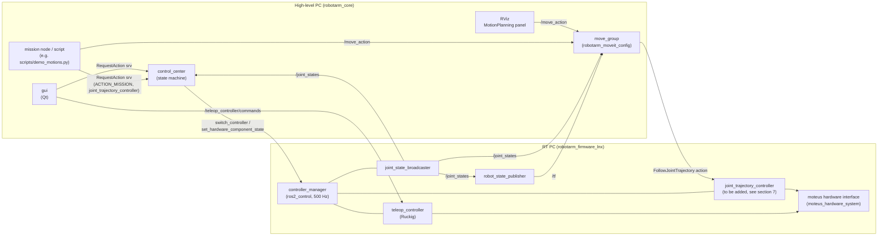

# robotarm_moveit_config

MoveIt 2 (ROS 2 Jazzy) configuration for the 6-axis robotarm: planning group, named poses,
collision matrix, inverse kinematics, joint/Cartesian limits, planning pipelines (OMPL, Pilz), and
how trajectories are sent to ros2_control. Also contains a standalone demo with simulated hardware.

The package has the same layout as a package generated by the MoveIt Setup Assistant, so you can
open and edit it with the Setup Assistant (see [section 5](#5-collision-matrix-and-setup-assistant)).

Contents

1. [Purpose and architecture](#1-purpose-and-architecture)
2. [File overview](#2-file-overview)
3. [Design decisions](#3-design-decisions)
4. [Quickstart](#4-quickstart)
5. [Collision matrix and Setup Assistant](#5-collision-matrix-and-setup-assistant)
6. [Using our own IK](#6-using-our-own-ik)
7. [Open issues / required changes outside this package](#7-open-issues--required-changes-outside-this-package)
8. [Known limitations and pitfalls](#8-known-limitations-and-pitfalls)
9. [Verification log](#9-verification-log)

---

## 1. Purpose and architecture

MoveIt is a motion planning framework. Given a goal (a named pose, joint values, or a TCP pose),
it computes a collision-free, time-parameterized **joint trajectory** that respects the joint
limits. MoveIt does not control motors itself. It hands the finished trajectory to a
**controller** (here the ros2_control `joint_trajectory_controller`), which interpolates it in the
real-time loop and commands the hardware.

The central MoveIt process is **`move_group`**. It holds the robot model (URDF + SRDF), the planning
scene (robot + obstacles), the IK solver and the planners, and offers ROS actions/services such as
`/move_action` (plan and/or execute), `/execute_trajectory` and `/compute_ik`, `/compute_fk`.
The RViz **MotionPlanning** panel and scripts are just clients of `move_group`.

This package only contains **configuration and launch files** for `move_group`.



Responsibilities:

| Component | Runs on | Responsibility |
|---|---|---|
| ros2_control (`controller_manager`, controllers, moteus hardware interface) | RT PC | real-time loop, interpolation, motor commands, `/joint_states` |
| `control_center` | high-level PC | system state machine (IDLE → CONNECTED → ARMED → MISSION), arms the hardware, **activates/deactivates controllers** |
| `move_group` (this package) | high-level PC | planning; sends trajectories to `joint_trajectory_controller` **while it is active** |
| `gui` | high-level PC | operator UI, manual jogging via `teleop_controller` |

Typical flow for a MoveIt motion on the real robot (after the changes in section 7): the client
asks `control_center` for a mission with `controller_names = "joint_trajectory_controller"`,
control_center activates that controller, the client sends goals to `move_group`, and at the end it
stops the mission (controller is deactivated again).

For development without the robot, `launch/demo.launch.py` starts everything from the RT PC column
(except the moteus hardware) locally with mock hardware.

---

## 2. File overview

```
robotarm_moveit_config/
├── .setup_assistant              where the URDF and SRDF are (read by Setup Assistant and MoveItConfigsBuilder)
├── CMakeLists.txt                installs config/, launch/, .setup_assistant, scripts/demo_motions.py
├── package.xml                   all runtime dependencies (rosdep)
├── README.md                     this file
├── config/
│   ├── robotarm.srdf             planning group, named poses, disabled collision pairs
│   ├── kinematics.yaml           IK solver (pick_ik)
│   ├── joint_limits.yaml         velocity/acceleration limits (PRELIMINARY)
│   ├── pilz_cartesian_limits.yaml  TCP limits for Pilz LIN/CIRC (PRELIMINARY)
│   ├── ompl_planning.yaml        OMPL pipeline
│   ├── pilz_industrial_motion_planner_planning.yaml  Pilz pipeline
│   ├── moveit_controllers.yaml   which controller MoveIt sends trajectories to
│   ├── ros2_controllers.yaml     ros2_control config, DEMO ONLY
│   └── moveit.rviz               RViz layout with MotionPlanning panel
├── launch/
│   ├── demo.launch.py            standalone demo with mock hardware
│   ├── move_group.launch.py      move_group (+ RViz) only, for the real robot
│   └── setup_assistant.launch.py opens this package in the Setup Assistant
└── scripts/
    └── demo_motions.py           test script: OMPL, Pilz PTP, Pilz LIN
```

### `.setup_assistant`

A small YAML file. It says which URDF the config belongs to (`robotarm_description`,
`urdf/robotarm.urdf.xacro`, xacro argument `use_hardware:=false`) and where the SRDF is.
`MoveItConfigsBuilder` reads it to find the URDF, so no URDF copy exists in this package.
*Adjust:* only if the URDF moves or needs other xacro arguments.

### `config/robotarm.srdf`

The **Semantic Robot Description Format** adds to the URDF what MoveIt needs beyond geometry:

- **Planning group `arm`**: chain `Base_1 → tcp`, i.e. joints `axis1..axis6`. The tip link of the
  chain (`tcp`) is the link that is moved to pose goals and that carries the interactive marker in RViz.
- **Named states** (`group_state`), usable by name from RViz ("Goal State" dropdown) and code:
  - `home`: all joints 0. The arm is stretched horizontally forward, TCP at about x = 0.73 m,
    z = 0.37 m, at the edge of the workspace (fully stretched = singular).
  - `ready`: `0, -1.3, 1.5, 0, 1.0, 0`. The arm is bent, TCP in front of the robot at about
    x = 0.41 m, z = 0.47 m. `axis5 = 1.0` keeps the wrist away from the singularity at `axis5 = 0`
    (axes 4 and 6 aligned), where IK and Cartesian motions become ill-conditioned. Good start pose
    for Cartesian motions.
- **No virtual joint**: `Base_1` is the root of the URDF and the fixed planning frame. (A virtual
  joint would only be needed if the robot were mounted on something moving or had to be placed
  in a `world` frame.)
- **`disable_collisions`**: link pairs that are never checked for self-collision. `Adjacent` =
  connected by a joint (always touching), `Never` = found collision-free in 100 000 random
  configurations. Fewer pairs to check = faster planning. Generated automatically, see section 5.

*Adjust:* add named states; regenerate the collision matrix whenever the URDF geometry or joint
limits change.

### `config/kinematics.yaml`

IK solver for the group `arm`: **pick_ik** (`pick_ik/PickIkPlugin`) in `global` mode, with tight
thresholds (0.1 mm, 0.001 rad) because Pilz LIN solves IK for every point on the line.
The file also documents the KDL fallback and how to plug in our own IK (section 6).
*Adjust:* `kinematics_solver_timeout`, `mode` (`local` for servoing), thresholds, cost weights.

### `config/joint_limits.yaml` — PRELIMINARY

Velocity and acceleration limits per joint, used for time parameterization (OMPL pipeline) and by
Pilz. Position limits come from the URDF.

| Joints | max_velocity | max_acceleration |
|---|---|---|
| axis1..3 | 0.8 rad/s | 1.5 rad/s² |
| axis4..6 | 1.0 rad/s | 2.0 rad/s² |

`default_velocity_scaling_factor` / `default_acceleration_scaling_factor` = 0.1: requests that do
not specify a scaling (e.g. RViz with sliders left at the default) run at 10 % of these limits.
*Adjust:* after measuring on hardware. The velocity may not exceed the URDF `velocity` (currently the
placeholder 1.0), otherwise Pilz does not start.

### `config/pilz_cartesian_limits.yaml` — PRELIMINARY

TCP limits for Pilz LIN/CIRC: 0.1 m/s, 0.25 m/s² (acc/dec), 0.5 rad/s. The Setup Assistant
defaults (1 m/s, 2.25 m/s², 1.57 rad/s) are far too fast for a first test.

### `config/ompl_planning.yaml`

OMPL pipeline: planner plugin, request/response adapters, and the group section for `arm`
(default planner `RRTConnect`; `RRTstar`, `PRM`, `BiTRRT` selectable in RViz). The parameters of all
OMPL planners come from `moveit_configs_utils/default_configs/ompl_defaults.yaml` (merged
automatically because this file has no top-level `planner_configs`).
*Adjust:* `longest_valid_segment_fraction` (collision check resolution), planner list.

### `config/pilz_industrial_motion_planner_planning.yaml`

Pilz pipeline (PTP, LIN, CIRC) and the sequence capabilities (`/sequence_move_group` action for
blended motion sequences). Same as the `moveit_configs_utils` default; kept here for visibility.

### `config/moveit_controllers.yaml`

`moveit_simple_controller_manager` with one `FollowJointTrajectory` controller
`joint_trajectory_controller` (action `/joint_trajectory_controller/follow_joint_trajectory`,
joints `axis1..6`), plus execution monitoring tolerances (`trajectory_execution.*`).
*Adjust:* controller name must equal the name in ros2_control (demo and firmware).

### `config/ros2_controllers.yaml` — demo only

ros2_control configuration for `demo.launch.py`: `controller_manager` at 500 Hz with
`joint_state_broadcaster` and `joint_trajectory_controller` (command: position + velocity,
state: position + velocity). **Not used on the real robot**; the RT PC has its own configuration.

### `config/moveit.rviz`

RViz layout: MotionPlanning display (planning group `arm`, goal marker enabled), grid, fixed frame
`Base_1`.

### `launch/demo.launch.py`

Standalone demo: `robot_state_publisher`, `ros2_control_node` with **mock hardware**
(`mock_components/GenericSystem`, selected by `use_hardware:=false` in the URDF), spawners for
`joint_state_broadcaster` and `joint_trajectory_controller` (both active), and
`move_group.launch.py`. Argument `rviz:=true|false`.

### `launch/move_group.launch.py`

Only `move_group` (+ RViz, `rviz:=true|false`, default `true`). Starts **no** controller_manager and
**no** robot_state_publisher; use it against the real ros2_control stack. Here all MoveIt
parameters are assembled with `MoveItConfigsBuilder`, including `moveit_manage_controllers=False`
and the two planning pipelines (default: OMPL).

### `launch/setup_assistant.launch.py`

Opens the *installed* copy of this package in the Setup Assistant (standard file generated by the
Setup Assistant). To edit the package, open the source directory instead (section 5).

### `scripts/demo_motions.py`

Test script for the demo, using only `rclpy` + `moveit_msgs` (MoveGroup action `/move_action`,
FK service `/compute_fk`):

- (a) OMPL: plan + execute to `ready`
- (b) Pilz PTP: plan + execute to `home`
- (c) Pilz LIN: +5 cm in z from `ready`, plan only (or `--execute-lin`)

For every motion it checks the result code, that no joint exceeds scaling × `joint_limits.yaml`, that
the goal was reached (`/joint_states`), and for LIN that the TCP path is a straight line of the
requested length. Options: `--scaling` (default 0.5), `--execute-lin`, `--dz`.

---

## 3. Design decisions

### OMPL and Pilz

- **OMPL** (default in RViz) is a collection of *sampling-based* planners. It finds collision-free
  paths around obstacles, but the path is random (different on each run) and not straight in
  Cartesian space. Use it for "get from A to B somehow, avoid obstacles".
- **Pilz industrial motion planner** creates *analytic* motions as known from industrial robot
  programming: `PTP` (all axes synchronized in joint space), `LIN` (straight TCP line), `CIRC`
  (TCP arc). They are deterministic and predictable, and the velocity profile is trapezoidal. Pilz
  does **not** plan around obstacles; it only rejects a colliding trajectory. Use it for
  programmed, repeatable motions (pick and place approach/retreat, process paths).

Both are loaded in one `move_group`; each request chooses one with `pipeline_id` and `planner_id`.

### pick_ik as IK solver

- KDL, the classic default, is a simple Newton-Raphson solver. It often fails far from the seed,
  and it has no cost terms.
- pick_ik solves the same problem numerically, with better success rates, and has a global mode (evolutionary search)
  and optional costs (stay close to the current state, avoid joint limits). It works for any chain
  without code generation (unlike IKFast), so it also works while the geometry still changes.
- Later our analytic IK (`robotarm_rbd`) can replace it with one line in `kinematics.yaml` (section 6).

### Conservative limits

The URDF contains placeholder limits and no acceleration limits. The limits here are well below
what the TeleopController uses (3 rad/s, 4 rad/s²), and the default scaling is 10 %. MoveIt
trajectories can be long, fast, and far from where the operator expects, so the first tests on
hardware should be slow. Raise the values step by step after measuring.

### `moveit_simple_controller_manager` instead of `moveit_ros_control_interface`

MoveIt can use `moveit_ros_control_interface/Ros2ControlManager`, which activates and deactivates
ros2_control controllers **by itself** whenever it needs one. In our system, controller switching
belongs to `control_center`. It enforces the state machine: the hardware must be armed, and only one
mission may be active. It also deactivates controllers on STOP/ERROR. If MoveIt switched controllers
as well, it could activate a controller behind control_center's back, for example after a STOP.
Therefore:

- `moveit_simple_controller_manager` only knows the name of the action server; it never calls
  `switch_controller`.
- `moveit_manage_controllers=False` in `move_group.launch.py` makes this explicit.
- If `joint_trajectory_controller` is not active, the action goal is rejected and MoveIt reports
  the execution as failed. Nothing moves.

### Own demo mock instead of the firmware mock

`robotarm_firmware_lnx` also has a mock setup, but it currently has no
`joint_trajectory_controller` (section 7), it lives in another repository, and its controller setup
is made for teleop. The demo here uses the same URDF with `use_hardware:=false` and a minimal,
self-contained `ros2_controllers.yaml`. You can test MoveIt with only this repository.
Once the firmware has a `joint_trajectory_controller`, `move_group.launch.py` can be used against its
mock in exactly the same way as against the real robot.

---

## 4. Quickstart

### Install dependencies (once per container)

```bash
sudo apt update
sudo apt install ros-jazzy-moveit ros-jazzy-pick-ik ros-jazzy-ros2-controllers
# or, equivalently, from package.xml:
rosdep update
rosdep install --from-paths src/robotarm_moveit_config --ignore-src -y
```

(In the devcontainer you are root, so `sudo` is not needed. The Dockerfile does not install these
packages yet; see section 7.)

### Build

```bash
cd /robotarm_core
source /opt/ros/jazzy/setup.bash
colcon build --packages-up-to robotarm_moveit_config
source install/setup.bash
```

### Start the demo

```bash
ros2 launch robotarm_moveit_config demo.launch.py            # with RViz
ros2 launch robotarm_moveit_config demo.launch.py rviz:=false  # headless
```

Wait for `You can start planning now!` in the output. Quick checks in a second terminal:

```bash
ros2 control list_controllers      # both controllers "active"
ros2 topic hz /joint_states        # ~500 Hz
ros2 run robotarm_moveit_config demo_motions.py   # runs the test motions (a)-(c)
```

### Plan and execute in RViz

1. In the **MotionPlanning** panel, tab **Planning**: "Planning Group" is `arm`.
2. Set a goal:
   - either drag the **interactive marker** at the TCP (arrows = translate, rings = rotate).
     The orange robot shows the goal state; it turns red if the IK has no solution or the pose collides.
   - or choose a named state in **Goal State** (e.g. `ready`) and click **Update**.
3. Set **Velocity Scaling** / **Accel. Scaling** (e.g. 0.5 for the demo).
4. Click **Plan**. The planned trajectory is animated (enable "Show Trail" under
   Displays → MotionPlanning → Planned Path to see the whole path).
5. Click **Execute** (or **Plan & Execute**). The grey robot (actual state from `/joint_states`) moves.

Try other planners in the **Context** tab (top part of the panel):

- "Planning library": `ompl` → choose `RRTConnect`, `RRTstar`, ...
- "Planning library": `pilz_industrial_motion_planner` → choose `PTP` or `LIN`. Put the goal a few
  centimetres from the current TCP pose. With `LIN` the TCP then moves on a straight line.
  (`CIRC` needs an extra path constraint, which cannot be set in the panel.)

---

## 5. Collision matrix and Setup Assistant

### Regenerating the collision matrix

The Setup Assistant contains a command line tool that samples random joint configurations and
computes which link pairs can be disabled. Run it whenever the URDF geometry or joint limits change:

```bash
cd /robotarm_core
colcon build --packages-up-to robotarm_moveit_config && source install/setup.bash
ros2 run moveit_setup_assistant collisions_updater \
  --urdf $(ros2 pkg prefix robotarm_description)/share/robotarm_description/urdf/robotarm.urdf.xacro \
  --xacro-args use_hardware:=false \
  --srdf src/robotarm_moveit_config/config/robotarm.srdf \
  --output src/robotarm_moveit_config/config/robotarm.srdf \
  --default --trials 100000
```

- `--default` also disables pairs that already collide in the zero pose (none at the moment).
- Without `--keep`, all existing `disable_collisions` entries are replaced by the new result.
- The rest of the SRDF (groups, named states) is kept.
- Check the result with `git diff`. "Never" is a statistical result; if a pair can collide in a rare
  configuration, remove its line by hand.

(You may see a warning `Found remap rule 'use_hardware:=false'`; it comes from rcl parsing the xacro
argument and is harmless.)

The same can be done graphically in the Setup Assistant, page "Self-Collisions".

### Opening the package in the Setup Assistant

```bash
source install/setup.bash    # robotarm_description must be built
ros2 run moveit_setup_assistant moveit_setup_assistant \
  --config_pkg=/robotarm_core/src/robotarm_moveit_config
```

Pass the **source** directory. The standard `ros2 launch robotarm_moveit_config setup_assistant.launch.py`
also works for viewing, but it opens the *installed* copy in `install/`, so "Generate Package" would
write there and the changes would be lost on the next build.

The Setup Assistant reads `.setup_assistant`, loads the URDF from `robotarm_description` and the
SRDF, and opens with the package loaded. Things to know before clicking "Generate Package":

- **Page "ros2_control URDF Modification"**: do **not** add interfaces. Our URDF already has its
  own ros2_control block (`moteus_hardware_system`). Otherwise the Setup Assistant creates
  `config/robotarm.urdf.xacro` + `robotarm.ros2_control.xacro`, and `MoveItConfigsBuilder` would
  then load that file instead of the original URDF.
- **Page "Configuration Files"**: only select the files you changed. Uncheck
  `package.xml`, `CMakeLists.txt`, the launch files, `ros2_controllers.yaml` and
  `moveit_controllers.yaml`, otherwise our versions (comments, `moveit_manage_controllers`,
  pipelines) are overwritten with generic templates.
- The Setup Assistant rewrites the SRDF completely; custom XML comments in it are lost.
- Review everything with `git diff` afterwards.

---

## 6. Using our own IK

`robotarm_rbd` (in the `robotarm_description` repository) implements
`kinematics_interface::KinematicsInterface`. That is the **ros2_control** kinematics interface
(FK, Jacobian, used by controllers like admittance control), **not** the MoveIt IK interface. Its
closed-form IK is not implemented yet. To use it in MoveIt, write a small adapter plugin:

1. **Base class:** `kinematics::KinematicsBase` from `moveit_core`,
   header `<moveit/kinematics_base/kinematics_base.hpp>`.
2. **Methods to implement:**
   - `initialize(node, robot_model, group_name, base_frame, tip_frames, search_discretization)`.
     Read the chain from the `RobotModel`, create the `robotarm_rbd` model, and read parameters
     from `robot_description_kinematics.arm.*`.
   - `getPositionIK(...)`: one solution close to the seed state.
   - `searchPositionIK(...)` (several overloads, with timeout, consistency limits and a solution
     callback). This is the main call from MoveIt. With a closed-form IK: compute all (up to 8)
     solutions, drop those outside the joint limits or rejected by the callback (collision
     check), and return the one closest to the seed.
   - `getPositionFK(...)`.
   - `getJointNames()`, `getLinkNames()`.
   - Optional: `getPositionIK` with multiple solutions (`std::vector<std::vector<double>>`), which
     Pilz and Cartesian planning can use.
3. **Export with pluginlib:** `PLUGINLIB_EXPORT_CLASS(robotarm_rbd::MoveItKinematicsPlugin,
   kinematics::KinematicsBase)`, plus a plugin XML with `base_class_type="kinematics::KinematicsBase"`,
   registered with `pluginlib_export_plugin_description_file(moveit_core <xml>)`.
   Best as its own small package (e.g. `robotarm_moveit_ik`), so `robotarm_rbd` stays
   free of MoveIt dependencies.
4. **Switch** in `config/kinematics.yaml`:
   ```yaml
   arm:
     kinematics_solver: robotarm_rbd/MoveItKinematicsPlugin
     kinematics_solver_timeout: 0.005
   ```
   and add the package as `exec_depend` in `package.xml`.

Reference implementations: `kdl_kinematics_plugin` (moveit_kinematics) and pick_ik.

---

## 7. Open issues / required changes outside this package

These things were noticed while writing this package. **None of them were changed**, because they are
outside this package.

### Needed for MoveIt on the real robot

1. **`joint_trajectory_controller` in `robotarm_firmware_lnx`** (repository not available here,
   based on the task description): the RT PC only runs the custom `teleop_controller`. Without a
   `joint_trajectory_controller`, MoveIt cannot execute anything on the real robot. Required:
   - in `controllers.yaml`: controller `joint_trajectory_controller`
     (`joint_trajectory_controller/JointTrajectoryController`), joints `axis1..axis6`,
     command interfaces `position, velocity`, state interfaces `position, velocity`
     (same as `config/ros2_controllers.yaml` here),
   - in **both** launch files (real hardware and mock): spawn it **inactive**
     (`spawner joint_trajectory_controller --inactive`).
2. **Activation through `control_center`**: a MoveIt client (mission node) sends
   `RequestAction(ACTION_MISSION, TYPE_START, controller_names="joint_trajectory_controller")`
   before and `TYPE_STOP` after the MoveIt motions. `control_center` supports this already. Open points:
   - Nothing in the GUI or elsewhere starts such a mission yet. A mission node or a GUI button is needed.
   - `teleop_controller` and `joint_trajectory_controller` claim the same command interfaces.
     `on_enter_mission_before` activates with `STRICT` and deactivates nothing, so teleop has to be
     stopped first, otherwise the switch fails.
   - A running MoveIt execution is not cancelled when control_center deactivates the controller. The
     JTC aborts the goal, and MoveIt reports `CONTROL_FAILED`. That is acceptable, but should be tested.
3. **`teleop_controller` lists only `axis1–3` in `controllers.yaml`** (firmware repo, per the task
   description). With 6 axes, axis4..6 cannot be jogged.
4. **Placeholder limits in the URDF** (`robotarm_description/urdf/robotarm_geometry.xacro`): all joints
   have `velocity="1" effort="1"`. MoveIt only uses the velocity (as an upper bound for
   `joint_limits.yaml`), but `robotarm_rbd`, the GUI (reads limits from the URDF) and possibly the
   hardware interface use them too. Real values are needed; acceleration limits cannot be expressed
   in URDF and stay in `joint_limits.yaml`.
5. **Dockerfile** (`.devcontainer/Dockerfile`) does not install MoveIt, pick_ik or ros2_controllers.
   After a container rebuild they are gone. Add
   `ros-${ROS_DISTRO}-moveit ros-${ROS_DISTRO}-pick-ik ros-${ROS_DISTRO}-ros2-controllers`.

### Other findings

6. **robotarm_interface**:
   - `CMakeLists.txt` only generates `RequestAction.srv`, `SystemStatus.msg` and `SetFloat64.srv`.
     The messages `AxisData`, `MotorParameter`, `TrajectoryFrame`, the service `CANFDTunnel` and all
     actions (`Mission`, `PlanCSV`, `PlanJointSpace`, `ConfigMotor`, `ReadMotorConfigs`) are not
     built. Actions would also need `action_msgs` as a dependency.
   - `PlanJointSpace.action` uses a type `JointAngles` that does not exist.
7. **Wrong/missing dependencies in package.xml files** (`rosdep install` fails for the whole workspace):
   - `gui/package.xml` depends on `interface`; the package is called `robotarm_interface`.
   - `robot_bringup/package.xml` depends on `interface`, `mission_controller`, `udp_agent`,
     `hardware_simulation`, which do not exist in this repository.
   - `control_center/package.xml` lacks `rclpy`, `sensor_msgs`, `lifecycle_msgs`,
     `python3-transitions`. `gui` has similar gaps.
8. **GUI speed service name**: `manual_control_widget.py` creates a client for
   `/teleop_controller/scale_speed` but the warning mentions `/teleop_controller/set_speed`. One of
   the two is wrong (depends on the firmware).
9. **`rviz.launch.py`**: exists in `robotarm_description/launch/` and is included by
   `robot_bringup/launch/launch_robot.py`. It was reported as missing, but it is present in this
   repository. If a launch file in the firmware repo refers to it, check the path there.
10. **KDL warning about root inertia**: `robot_state_publisher` warns
    `The root link Base_1 has an inertia specified in the URDF, but KDL does not support a root link with an inertia`.
    Harmless for MoveIt; it goes away if the inertia of `Base_1` is removed or a dummy root link is added.
11. **Workspace build fails in `robotarm_rbd` tests**: a plain `colcon build` of the whole workspace
    builds all other packages. `robotarm_rbd` fails because
    `robotarm_rbd/test/robotarm_rbd_test.cpp` uses `intertia_` (twice) instead of the member
    `inertia_`. The library itself builds (`--cmake-args -DBUILD_TESTING=OFF`). This does not affect
    `colcon build --packages-up-to robotarm_moveit_config`. `robotarm_rbd` also needs
    `kinematics_interface`, which comes with `ros-jazzy-ros2-controllers`.

---

## 8. Known limitations and pitfalls

- **Never run the demo in parallel with the firmware mock or the real robot** (same ROS domain).
  Both provide `/controller_manager`, `/joint_states`, `/robot_description` and `/tf`. MoveIt then sees
  two robots with jumping joint states, and `control_center` may switch controllers in the wrong
  controller_manager. Use a different `ROS_DOMAIN_ID` if you really need both.
- **Mock hardware is perfect**: `GenericSystem` copies commands to states. Tracking errors, torque
  limits, and dynamics are not simulated. A trajectory that runs in the demo can still fail on hardware.
- **No obstacles**: the planning scene only contains the robot (self-collision). Table, walls and
  cables are unknown to MoveIt. Add them as collision objects (RViz "Scene Objects" tab or
  `/apply_planning_scene`) before using OMPL near real obstacles. Pilz ignores obstacles unless
  the result collides.
- **Log messages at startup** that are expected and harmless:
  - `[occupancy_map_monitor]: No 3D sensor plugin(s) defined for octomap updates` (ERROR) and
    `Resolution not specified for Octomap` (WARN). There are no depth sensors configured.
  - The KDL root-inertia warning (section 7, item 10).
- **Collision matrix "Never" is statistical** (100 000 samples); see section 5.
- **Default scaling is 10 %.** RViz motions are slow on purpose; raise the sliders in the panel.
- **Pilz LIN near singularities / workspace boundary**: LIN through or near `axis5 = 0` (wrist
  singularity) or from the fully stretched `home` pose fails with `NO_IK_SOLUTION`. From `home`, a
  5 cm move up or down with the same tool orientation is simply out of reach (verified with
  `/compute_ik`). Start Cartesian motions from `ready`-like poses.
- **move_group crashes on shutdown**: pressing Ctrl-C prints a segmentation fault of `move_group`
  in `rclcpp::Executor::~Executor()`. This happens in the MoveIt 2.12.4 binary while it shuts down,
  after all planning has stopped. It does not come from this configuration and has no effect.
- **pick_ik `global` mode** can jump to a different IK branch when you drag the marker (e.g.
  flip the wrist). Increase `minimal_displacement_weight` in `kinematics.yaml` if this is annoying.
- **Changing the URDF**: after changing link names, joint names or limits, update the SRDF,
  `joint_limits.yaml`, `moveit_controllers.yaml`, `ros2_controllers.yaml`, and regenerate the
  collision matrix.
- **`use_hardware` in `move_group.launch.py`**: the URDF is loaded with `use_hardware:=false`. This
  only changes the ros2_control plugin tag, which move_group ignores, so it is correct for the
  real robot too.

---

## 9. Verification log

Initial verification when the package was created (2026-09-29). Environment: devcontainer, ROS 2 Jazzy,
MoveIt 2.12.4, pick_ik, ros2_controllers from apt, `RMW_IMPLEMENTATION=rmw_cyclonedds_cpp`,
`robotarm_description` at commit `1265c65`.

### Build

```bash
colcon build --packages-up-to robotarm_moveit_config
rosdep check --from-paths src/robotarm_moveit_config --ignore-src
ament_flake8 --linelength 100 src/robotarm_moveit_config
```

Result: clean build of `robotarm_description` + `robotarm_moveit_config`, **no warnings**;
`All system dependencies have been satisfied`; flake8 without findings.

### URDF

`xacro robotarm.urdf.xacro use_hardware:=false` expands without errors; `check_urdf`: serial chain
`Base_1 → Shoulder_1 → Elbow_1 → Forearm_1 → Stage4_1 → Stage5_1 → Stage6_1 → tcp`; all 119
`package://` mesh references resolve.

### Headless demo

```bash
ros2 launch robotarm_moveit_config demo.launch.py rviz:=false
ros2 control list_controllers
ros2 control list_hardware_components
ros2 topic hz /joint_states
```

| Check | Result |
|---|---|
| move_group | `You can start planning now!`; OMPL and Pilz (PTP, LIN, CIRC) loaded; `Added FollowJointTrajectory controller for joint_trajectory_controller`; `Trajectory execution is not managing controllers` |
| controllers | `joint_state_broadcaster` and `joint_trajectory_controller` **active** |
| hardware | `moteus_hardware_system`, plugin `mock_components/GenericSystem`, active, 500 Hz; JTC claims `position` + `velocity` of axis1..6 |
| `/joint_states` | ~500 Hz, joints `axis1..axis6` |
| warnings/errors in log | only the expected ones listed in section 8 |

### Test motions

```bash
ros2 run robotarm_moveit_config demo_motions.py                # (a), (b), (c) plan only
ros2 run robotarm_moveit_config demo_motions.py --execute-lin  # (c) also executed
```

Scaling 0.5 (velocity and acceleration):

| Motion | Result | Duration | Check |
|---|---|---|---|
| (a) OMPL RRTConnect → `ready`, executed | SUCCESS | 4.28 s | goal reached (error 7e-5 rad, OMPL goal tolerance 1e-4); peak velocity exactly 100 % of 0.5 × limit |
| (b) Pilz PTP → `home`, executed | SUCCESS | 4.28 s | goal reached (error 1e-16 rad); peak velocity 100 % of 0.5 × limit |
| (c) Pilz LIN +5 cm z from `ready`, plan only | SUCCESS, 0.03 s planning | 1.40 s | TCP z 0.4658 → 0.5157 m (5.00 cm), max. deviation from straight line 0.046 mm |
| (c) with `--execute-lin` | SUCCESS | 1.40 s | same geometry, then PTP → `home` SUCCESS |

The durations match the configured limits. Axis3 moves 1.5 rad at 0.5 × 0.8 = 0.4 rad/s with
0.5 × 1.5 = 0.75 rad/s², giving 1.5/0.4 + 0.4/0.75 = 4.28 s. LIN: 5 cm at 0.5 × 0.1 = 0.05 m/s with
0.125 m/s², giving 1.0 + 0.4 = 1.40 s.

The first run with the pick_ik default thresholds (1 mm) gave a LIN of only 4.92 cm with 0.32 mm deviation.
That is why `kinematics.yaml` uses 0.1 mm / 0.001 rad.

Negative tests:

| Test | Result |
|---|---|
| `ros2 control set_controller_state joint_trajectory_controller inactive`, then execute PTP → `ready` | `CONTROL_FAILED`; JTC: `Can't accept new action goals. Controller is not running.`; no joint moved |
| Pilz LIN ±5 cm z from `home` | `NO_IK_SOLUTION` (out of reach, confirmed with `/compute_ik` for two seeds) |

### Demo with RViz

`ros2 launch robotarm_moveit_config demo.launch.py`: RViz starts. MotionPlanning display:
`Ready to take commands for planning group arm`, interactive markers connected. No plugin load
errors. The only messages are the harmless ones:
- `Action server: /recognize_objects not available` (ERROR; no object recognition is used)
- class_loader `namespace collision ... InteractiveMarkerDisplay` (upstream MoveIt/RViz linking issue)
- `Publisher already registered for node name: 'rviz2'`
- the KDL root inertia warning

The test script was run once more with RViz open; no new warnings from RViz. The visual
check (marker, planning, execution in the GUI) is still open.

### Setup Assistant

`moveit_setup_assistant --config_pkg=<src or install path>`: URDF and SRDF load without errors
(`Robot semantic model successfully loaded`). Generating the package from the Setup Assistant
was not tested.

### Collision matrix

`collisions_updater ... --default --trials 100000` (command in section 5): 6 `Adjacent` + 4 `Never`
pairs; no pair collides in the zero pose.

### Not verified here

- Operation against `robotarm_firmware_lnx` (repository not available; no `joint_trajectory_controller` there yet).

A full `colcon build` of the workspace was also run: all packages except `robotarm_rbd` build
(section 7, item 11).
